# Bản Đồ Chi Tiết Toàn Bộ Mã Nguồn `Room_Agent` (Directory & File-by-File Map)

> **Cập nhật**: `2026-10-27`  
> **Kiến trúc**: **SLPC Multi-Agent Operating System** (`Supervisor` ➔ `Lead` ➔ `Peer` ➔ `QC`)  
> **Nền tảng**: Orca Desktop Worktrees + Paseo Runtime + Hermes Agent + Harness² (Floci DynamoDB / SQLite / Rust CLI) + Kev System One (`<50ms` Feasibility Engine) + RTK (Rust Token Killer)

---

## 🗺️ Sơ Đồ Tổng Quan Kiến Trúc Thư Mục

```mermaid
flowchart TD
    Root["Room_Agent (Root)"]
    Root --> RootFiles["Root Config & CLI Entrypoints\n(AGENTS.md, WORKSPACE_PROTOCOL.md, agent-start, trigger-flow...)"]
    Root --> RTK[".rtk/\n(Rust Token Killer Pipelines)"]
    Root --> GH[".github/workflows/\n(CI & SLPPC Governance Guard)"]
    Root --> Profiles["profiles/\n(4 Hồ sơ nhân cách & RBAC của Agent)"]
    Root --> Plugins["plugins/slpc-lifecycle-hooks/\n(Bộ điều phối tự động SLPC & Paseo Lifecycle Hooks)"]
    Root --> Scripts["scripts/\n(Khởi tạo Worktree Rooms, Agent Start, Pipeline, Dashboard, Schema SQL)"]
    Root --> Tools["tools/\n(38 Công cụ vận hành Harness DB, Orca Bridge, Flow Guard, QC Generator...)"]
    Root --> BMAD["bmad/\n(Bộ não dùng chung: rooms/, wiki/, adrs/, architecture.json)"]
    Root --> Skills["profiles/<role>/skills/\n(Kho kỹ năng phân quyền theo vai trò + shared)"]
    Root --> Docs["docs/\n(Sổ cái AGENT_PROGRESS.md & 40+ tài liệu đặc tả kỹ thuật docs/spec/)"]
    Root --> Tests["tests/automation/\n(Playwright E2E Page Object Model & Test Data Factory)"]
```



---

## 1. Thư Mục Gốc (`/`) — Cấu Hình Toàn Cục & CLI 1-Chạm

| File | Loại | Nội dung & Chức năng chi tiết |
| :--- | :--- | :--- |
| [README.md](../README.md) | Markdown | Tài liệu giới thiệu tổng thể kiến trúc `Room_Agent`, mô hình 4 vai trò SLPC, sơ đồ luồng điều phối, hướng dẫn cài đặt nhanh và danh mục công cụ. |
| [AGENTS.md](../AGENTS.md) | Markdown | **Hiến pháp toàn cục của Workspace**: Quy định kỷ luật thép cho mọi Agent (Single-Ownership Invariant, Zero-Search 5 thành phần, Strict Typing `0 any/unknown`, Role Fencing, ISTQB 5-Stage). |
| [CLAUDE.md](../CLAUDE.md) | Markdown | Định nghĩa các custom slash commands (`/paseo`, `/harness`, `/room`) và chỉ thị nhanh dành cho Claude Code / Hermes Agent khi khởi động. |
| [WORKSPACE_PROTOCOL.md](../docs/WORKSPACE_PROTOCOL.md) | Markdown | Quy chuẩn vận hành không gian làm việc SLPC: phân biệt **Persistent Tabs** (`Supervisor` ở `main`, `Lead` ở `room-lead`) và **Ephemeral Sub-Agents** (`Peer` ở `room-peer`, `QC` ở `room-qc` — mở theo task và tự đóng khi `Resolved`/`Closed`). |
| [COMMANDS.md](../docs/COMMANDS.md) | Markdown | Bảng tra cứu nhanh (Cheatsheet) các câu lệnh CLI thường dùng (`./cli/agent-start`, `./cli/trigger-flow`, `./cli/orca-review`, `harness_manager.py`, `slppc_flow_guard.py`). |
| [agent-start](../cli/agent-start) | Symlink | Symlink trỏ tới `scripts/agent-start.sh` — CLI 1-chạm để bật/tắt/xem trạng thái các Agent (`./cli/agent-start`, `./cli/agent-start status`, `./cli/agent-start stop`). |
| [trigger-flow](../cli/trigger-flow) | Bash CLI | CLI 1-chạm (`./cli/trigger-flow "Tên Epic" "Mô tả"`) gọi `scripts/run_pipeline.py` để chạy tự động toàn bộ vòng đời `Supervisor ➔ Lead ➔ Peer ➔ QC`. |
| [orca-review](../cli/orca-review) | Bash CLI | CLI 1-chạm gọi `tools/orca_worktree_manager.py` để xem diff, chạy kiểm tra cơ học và phê duyệt (`approve`) hoặc từ chối (`reject`) merge từ nhánh room về `main`. |
| [setup.sh](../setup.sh) | Bash | Script cài đặt tổng thể 1 bước cho toàn bộ hệ thống SLPC (chuẩn hóa thư mục `bmad/rooms/`, dựng Orca worktrees, đồng bộ skills, đồng bộ 4 profiles, khởi tạo DB `--init-db` và khởi chạy `--launch`). |
| [paseo.json](../paseo.json) | JSON | Cấu hình Worktree Lifecycle Hooks của Paseo (`pre-create`, `post-create`, `pre-destroy` trỏ về `scripts/worktree_hook.sh`). |
| [package.json](../package.json) & [tsconfig.json](../tsconfig.json) | JSON | Cấu hình Node/TypeScript cho plugin `@getpaseo/plugin` và bộ kiểm thử E2E Playwright. |
| [requirements.txt](../requirements.txt) | Text | Danh sách thư viện Python cốt lõi (`boto3`, `requests`, `pyyaml`, ...). |
| [.env.example](../.env.example) | Env | Mẫu biến môi trường kết nối Floci DynamoDB/S3 (`FLOCI_ENDPOINT`), Kev System One (`SYSTEMONE_URL`), Azure DevOps PAT. |
| [.gitleaks.toml](../.gitleaks.toml) & [.gitignore](../.gitignore) | Config | Cấu hình quét rò rỉ khóa bí mật (Gitleaks) và danh sách loại trừ git (bảo vệ không commit file memo tạm, `.claude/`, `projects/`). |
| `harness.db` / `.harness_local_db.json` | Data | Cơ sở dữ liệu lưu trữ Work Items (Epic, Feature, Story, Task, Bug, Testcase) ở chế độ SQLite và Floci local JSON fallback. |
| `.harness_progress.json` | JSON | Dữ liệu gốc của sổ cái tiến độ phiên làm việc, được đồng bộ tự động ra `docs/AGENT_PROGRESS.md`. |

---

## 2. Thư Mục `.github/workflows/` & `.rtk/` — CI/CD & Nén Token Tự Động

### 2.1. `.github/workflows/`
| File | Nội dung & Chức năng chi tiết |
| :--- | :--- |
| [ci.yml](../.github/workflows/ci.yml) | Pipeline GitHub Actions chạy toàn bộ unit tests Python (`tools/tests/test_*.py`) và smoke test khi có PR/push. |
| [slppc-governance-guard.yml](../.github/workflows/slppc-governance-guard.yml) | Pipeline kiểm định kỷ luật SLPPC tự động: chạy `slppc_flow_guard.py audit`, `strict_typing_scanner.py` và `anti_leak_sentinel.py`. |

### 2.2. `.rtk/` (Rust Token Killer Pipelines)
| File | Nội dung & Chức năng chi tiết |
| :--- | :--- |
| [pipeline.toml](../.rtk/pipeline.toml) | Cấu hình gốc của RTK giúp nén 60–90% lượng token stdout/stderr của các lệnh shell trước khi đưa vào context của Agent. |
| [10-pm-head-gate.toml](../.rtk/pipelines/10-pm-head-gate.toml) | Pipeline lọc dữ liệu đầu vào cho cổng thẩm định PM (Kev System One Feasibility & Alignment). |
| [20-supervisor-lead-fences.toml](../.rtk/pipelines/20-supervisor-lead-fences.toml) | Pipeline rào cản quyền hạn (Role Fences): chặn Supervisor và Lead Dev trực tiếp sửa code sản phẩm. |
| [30-qc-tail-gate.toml](../.rtk/pipelines/30-qc-tail-gate.toml) | Pipeline hậu kiểm cho cổng QC (ép buộc chạy test cơ học đạt exit code `0` trước khi đóng task). |

---

## 3. Thư Mục `profiles/` — Hồ Sơ Nhân Cách, Quyền Hạn & Scoped Tools Của 4 Vai Trò SLPC

Mỗi vai trò trong `profiles/` tương ứng với một thư mục profile chuẩn (`profiles/<role>/PROFILE.md`, `IDENTITY.md`, `SOUL.md`, `MEMORY.md`, `skills/`):

| Thư mục Profile | Vai trò & Phòng (Worktree) | Nội dung & Nhiệm vụ cốt lõi |
| :--- | :--- | :--- |
| [profiles/supervisor/](../profiles/supervisor/PROFILE.md) | **Supervisor** (`main`) | **Scope & Intent Guard (Persistent)**: Tiếp nhận yêu cầu từ User, giữ cổng phạm vi dự án, thẩm định Kev System One (<50ms), khởi tạo Epic/Story trên Harness DB, điều phối qua Lead/Peer và nghiệm thu tổng thể. Cấm tự gõ code tính năng. |
| [profiles/lead/](../profiles/lead/PROFILE.md) | **Lead Dev** (`room-lead`) | **Technical Architect (Persistent)**: Thiết kế kiến trúc, tra cứu bài học cũ từ Harness², phân rã **Zero-Search Task** (đủ 5 mục: *Target Files, Anchors, Concrete Changes, Acceptance Criteria, Test Command*) cho Peer, và thực hiện 7-Point Code Review. Nghiêm cấm tự code (`role_trespass`). |
| [profiles/peer/](../profiles/peer/PROFILE.md) | **Peer** (`room-peer`) | **Unified Code & UI Executor (Ephemeral)**: Hợp nhất toàn bộ năng lực thi công mã nguồn Full-Stack (Angular 18 / Nx / TypeScript / Python) và ánh xạ thiết kế Figma sang TDS UI Tokens (`mcp__figma__*`, `tds_search.py`). Tự chạy unit test cục bộ và chuyển trạng thái task sang `Resolved` (cấm tự đóng `Closed`). |
| [profiles/qc/](../profiles/qc/PROFILE.md) | **QC Verifier** (`room-qc`) | **5-Stage ISTQB Independent Gate (Ephemeral)**: Sinh ma trận kiểm thử 5 tầng ISTQB, chạy kiểm thử cơ học độc lập, quét `strict_typing_scanner.py` & `slppc_flow_guard.py`. Là vai trò độc quyền chuyển Task sang `Closed`. |

---

## 4. Thư Mục `plugins/slpc-lifecycle-hooks/` — Trái Tim Điều Phối Tự Động SLPPC

Đây là plugin tích hợp trực tiếp vào Paseo Server/Client và Orca để lắng nghe sự kiện vòng đời của từng Agent và tự động chuyển tiếp trạng thái:

| File | Ngôn ngữ | Nội dung & Chức năng chi tiết |
| :--- | :--- | :--- |
| [paseo-plugin.json](../plugins/slpc-lifecycle-hooks/paseo-plugin.json) | JSON | Manifest định danh plugin `slpc-lifecycle-hooks` cho Paseo. |
| [slppc_orchestrator.py](../plugins/slpc-lifecycle-hooks/slppc_orchestrator.py) | Python | **Bộ Điều Phối Tự Động 5 Giai Đoạn (`SlppcOrchestrator`)**:<br>1. `handle_supervisor_ended()`: Đọc handoff của Supervisor ➔ chấm Feasibility qua Kev System One ➔ ghi `decision_memo.md` ➔ bắn lệnh cho `PM` trong `room-pm`.<br>2. `handle_pm_ended()`: Khi `PM` duyệt xong ➔ bắn lệnh `[PM TO LEAD]` sang `Lead Dev` trong `room-lead`.<br>3. `handle_lead_ended()`: Lấy Task mới phân rã ➔ tiêm bài học tự học Harness² (`query_lessons`) ➔ tự động mở (spawn) **Ephemeral Peer** trong `room-peer`.<br>4. `handle_peer_ended()`: Khi Task đạt `Resolved` ➔ **tự động đóng tab Peer (đưa RAM về 0)** ➔ trích xuất bài học (`record_lesson`) ➔ tự động mở **Ephemeral QC** trong `room-qc`.<br>5. `handle_qc_ended()`: Khi Task đạt `Closed` ➔ **tự động đóng tab QC** ➔ nén lưu trữ artifact vào `bmad/rooms/archive/` ➔ báo cáo hoàn tất cho `Supervisor`.<br>• Có cơ chế `resolve_shared_root()` và `_infer_terminal_room()` đảm bảo **mỗi room chỉ có tối đa 1 Agent duy nhất**. |
| [paseo_hooks.py](../plugins/slpc-lifecycle-hooks/paseo_hooks.py) | Python | Cầu nối hợp nhất 3 tầng Hook của Paseo (Plugin Lifecycle Hooks, Worktree Lifecycle Hooks, CLI Agent Hooks). Nhận sự kiện `agent.turn_ended`, nhận diện vai trò qua `infer_slpc_role()`, ghi log đã che mật khẩu vào `.harness_hooks.jsonl`, kích hoạt `SlppcOrchestrator` và dọn dẹp phòng task đã đóng (`clean_closed_task_rooms()`). |
| [index.server.ts](../plugins/slpc-lifecycle-hooks/index.server.ts) | TypeScript | Entrypoint phía Server của Paseo Plugin: gắn biến môi trường mặc định khi tạo Agent (`before:agent.create`), tự động chặn lệnh nguy hiểm (`rm -rf /`), tự động duyệt lệnh đọc an toàn (`SAFE_AUTO_APPROVE_PATTERN`), và bắn callback sang `paseo_hooks.py` khi `agent.turn_ended`. |
| [index.client.tsx](../plugins/slpc-lifecycle-hooks/index.client.tsx) | TypeScript/React | Giao diện cài đặt plugin trên Paseo Desktop UI để chọn và đồng bộ Supervisor Agent thread. |
| [server/hook-bridge.ts](../plugins/slpc-lifecycle-hooks/server/hook-bridge.ts) | TypeScript | Hàm helper gọi tiến trình con `paseo_hooks.py plugin-event` bất đồng bộ và trích xuất câu lệnh shell từ yêu cầu xin quyền của Agent. |
| [server/observer.ts](../plugins/slpc-lifecycle-hooks/server/observer.ts) | TypeScript | Lớp `SlppcObserver` quản lý trạng thái kết nối RPC giữa Paseo UI và Supervisor Agent đang hoạt động. |
| [shared/supervision.ts](../plugins/slpc-lifecycle-hooks/shared/supervision.ts) | TypeScript | Định nghĩa schema Zod dùng chung cho RPC `syncSupervisorRpc` và cấu hình giám sát Kev System One. |

---

## 5. Thư Mục `scripts/` — Quản Trị Phòng Worktree, Khởi Động Agent, Pipeline & Dashboard

| File | Loại | Nội dung & Chức năng chi tiết |
| :--- | :--- | :--- |
| [setup_rooms.sh](../scripts/setup_rooms.sh) | Bash | **Bộ Dựng Các Phòng Worktree Độc Lập**: Khởi tạo idempotent các thư mục Git/Orca Worktree (`room-lead`, `room-peer`, `room-qc`) tại `~/orca/workspaces/Room_Agent/`, tạo sẵn `latest_handoff.md` và symlink `projects/`, `.claude/`, `.agents/`. Hỗ trợ `--clean` và `--teardown`. |
| [agent_start.py](../scripts/agent_start.py) & [agent-start.sh](../scripts/agent-start.sh) | Python / Bash | **All-in-One Agent Controller (`./cli/agent-start`)**: Mặc định khởi chạy 2 Persistent Agents (`supervisor` ở `main`, `lead` ở `room-lead`), tự động kiểm tra theo worktree để không bao giờ mở trùng tab, đóng các shell thừa, và hiển thị bảng trạng thái nhịp tim (`./cli/agent-start status`). |
| [run_pipeline.py](../scripts/run_pipeline.py) | Python | **Real-Time Pipeline Runner (`./cli/trigger-flow`)**: Chạy tuần tự 4 pha từ dòng lệnh với KEV Dual-Anchor (Pre-flight Feasibility Gate ở đầu Supervisor qua Kev System One và Post-flight Settlement Verification ở cuối QC), tự động mở và thu hồi Ephemeral Sub-Agents. |
| [harness_dashboard.py](../scripts/harness_dashboard.py) | Python | **Web Server & Command Center Realtime**: Giao diện Dashboard trực quan theo dõi toàn bộ Work Items trên Harness DB, trạng thái các phòng BMAD Rooms, biểu đồ nhịp tim Agent và công cụ chạy kiểm thử QC. |
| [anti_leak_sentinel.py](../scripts/anti_leak_sentinel.py) | Python | **Chốt Chặn Chống Rò Rỉ Mã Nguồn Mở**: Quét toàn bộ repo để chặn địa chỉ vật lý công ty, domain nội bộ, private key, file memo tạm bị git track hoặc skill nằm sai thư mục. |
| [git_pre_commit_guard.py](../scripts/git_pre_commit_guard.py) | Python | Git Pre-commit Hook chặn commit nếu phát hiện vi phạm kỷ luật SLPC, lỗi strict typing hoặc rò rỉ dữ liệu. |
| [rtk_profile_env.sh](../scripts/rtk_profile_env.sh) | Bash | Nạp môi trường RTK (Rust Token Killer) theo từng vai trò Agent để tối ưu hóa kích thước context. |
| [worktree_hook.sh](../scripts/worktree_hook.sh) | Bash | Hook chạy khi Paseo tạo/xóa worktree, chuyển tiếp sự kiện về `plugins/slpc-lifecycle-hooks/paseo_hooks.py worktree`. |
| [harness](../scripts/harness) | Python CLI | CLI wrapper cho phép gọi nhanh các lệnh quản trị Harness DB (`scripts/harness list`, `stats`, ...). |
| [harness_init_db.py](../scripts/harness_init_db.py) & [harness_seed.py](../scripts/harness_seed.py) & [harness_cleanup.py](../scripts/harness_cleanup.py) | Python | Bộ script khởi tạo bảng DynamoDB/S3 trên Floci, nạp dữ liệu mẫu ban đầu và dọn dẹp các work item thử nghiệm. |
| [setup_harness_v0114.py](../scripts/setup_harness_v0114.py) | Python | Kiểm tra mã băm SHA-256 và cài đặt binary Rust `scripts/bin/harness-cli` (v0.1.14). |
| [patch_paseo.py](../scripts/patch_paseo.py) | Python | Đồng bộ 4 Profiles chuẩn SLPC (`Supervisor, Lead, Peer, QC` với provider `linux-prod` và model `ag/gemini-3.8-flash-high`) vào `~/.paseo/config.json`. |
| [start_orca.sh](../scripts/start_orca.sh) | Bash | Script tiện ích khởi động nhanh Orca Desktop. |
| `scripts/bin/harness-cli` | Binary | Binary thực thi tốc độ cao viết bằng Rust của Harness CLI (v0.1.14). |
| `scripts/schema/*.sql` (`001-init.sql` ➔ `007-experience.sql`, `full_schema.sql`) | SQL | Toàn bộ lịch sử migration và schema SQLite cho bảng `work_item`, `story`, `tool`, `intervention`, và `harness_experience` (kho bài học tự học Harness²). |

---

## 6. Thư Mục `tools/` — 38 Công Cụ Vận Hành Cốt Lõi Của Hệ Sinh Thái SLPPC

### 6.1. Quản trị Work Items, Cơ sở dữ liệu & Tự học (Harness² & Kev System One)
| File | Nội dung & Chức năng chi tiết |
| :--- | :--- |
| [harness_manager.py](../tools/harness_manager.py) | **Trình Quản Lý Tác Vụ Trung Tâm (`HarnessManager`)**: Thêm, sửa trạng thái (`New ➔ Accepted ➔ Active ➔ Resolved ➔ Closed`), xóa, truy vấn Work Items trên Floci DynamoDB hoặc SQLite. Tích hợp **Role Fence** (cấm Dev tạo Epic hoặc tự đóng Task sang `Closed`, cấm gán Task code cho Lead/Supervisor), tự động kích hoạt Agent qua Orca (`auto_dispatch_agent`) và tự động đóng Ephemeral Sub-Agent khi xong việc. |
| [floci_client.py](../tools/floci_client.py) | **Floci Cloud & Local Fallback Client (`FlociHarnessDB`)**: Giao tiếp với DynamoDB & S3 qua endpoint Floci; khi offline tự động chuyển mượt mà sang file JSON dùng chung `.harness_local_db.json` mà không làm gián đoạn Agent. |
| [harness_rust.py](../tools/harness_rust.py) | Cầu nối Python có kiểu dữ liệu chặt chẽ (Typed Bridge) gọi xuống binary Rust `harness-cli` và Kev System One để truy vấn bài học kinh nghiệm (`query_lessons`) và ghi nhận bài học mới (`record_lesson`). |
| [harness_learning_search.py](../tools/harness_learning_search.py) | Công cụ tra cứu, chấm điểm chất lượng và thanh lọc kho tri thức tự học (`harness_experience`), giúp Lead và Peer tránh lặp lại lỗi cũ. |
| [harness_doctor.py](../tools/harness_doctor.py) | **Bác Sĩ Hệ Thống (`Harness Doctor`)**: Kiểm tra sức khỏe toàn diện (kết nối Floci, SQLite schema, Paseo daemon, Orca runtime, cấu hình rooms) và tự động sửa lỗi (`--heal`). |

### 6.2. Điều phối Terminal Orca, Context Window, Nhịp Tim & Thu Hồi Tài Nguyên
| File | Nội dung & Chức năng chi tiết |
| :--- | :--- |
| [agent_context_manager.py](../tools/agent_context_manager.py) | **Quản Trị Context Window & Chống Đè Lệnh**:<br>• `get_live_terminals()` & `has_live_terminal()`: Quét terminal theo worktree (`room-lead`, `room-peer`, `room-qc`, `main`), tự động đóng các tab trùng lặp trong cùng room.<br>• `inspect_terminal()`: Đọc màn hình TUI để biết Agent đang rảnh (`❯`) hay bận và đo số lượng token.<br>• `compact_agent_terminal()`: Tự động gửi `/compact` khi vượt ngưỡng tokens.<br>• `rehydrate_agent()`: Tự động chạy `/new` và nạp lại hồ sơ vai trò + task active + handoff gần nhất. |
| [orca_slpc_bridge.py](../tools/orca_slpc_bridge.py) | Bộ điều phối SLPPC trên Orca Orchestration Engine: khởi tạo Orca Run, tạo Task kèm Decision Gate (`QC-Signoff`), tạo sandbox `bmad/rooms/tasks/<id>/` và gửi lệnh an toàn vào terminal. |
| [orca_worktree_manager.py](../tools/orca_worktree_manager.py) | Quản lý vòng đời Git/Orca Worktree và cổng phê duyệt **Human-in-the-Loop Review Gate** (`./cli/orca-review status/diff/approve/reject`) trước khi merge code từ nhánh room về `main`. |
| [orca_harness_bridge.py](../tools/orca_harness_bridge.py) | Đồng bộ trạng thái Work Item từ Harness DB lên thẻ hiển thị của Orca Workspace Board (`comment`, `workspaceStatus`). |
| [call_agent.py](../tools/call_agent.py) | Công cụ gọi/đánh thức một Agent theo profile (`--profile lead --prompt "..."`), tự động tiêm chỉ thị tư duy (`Thinking Directive`) và gửi trực tiếp vào terminal Orca của room tương ứng. |
| [dispatch_broker.py](../tools/dispatch_broker.py) | Event Bus đẩy gói công việc (Work Packet) trực tiếp vào PTY terminal hoặc hàng đợi `dispatch_queue.json` mà không cần polling. |
| [zombie_reaper.py](../tools/zombie_reaper.py) | **Zombie Terminal Reaper & Watchdog Daemon**: Bảo vệ đúng 1 Agent chính trong các phòng thường trực (`main`, `room-lead`), tự động thu hồi (close `--tab`) mọi terminal mồ côi hoặc bản sao dư thừa, và ngắt các Agent bị treo quá ngưỡng timeout (`300s`). |
| [agent_heartbeat.py](../tools/agent_heartbeat.py) & [agent_heartbeat_watcher.py](../tools/agent_heartbeat_watcher.py) | Ghi nhận nhịp tim định kỳ của từng Agent vào `bmad/rooms/heartbeats.json` và chạy daemon ngầm phát hiện Agent bị treo để báo động cho Supervisor. |
| [agent_scanner.py](../tools/agent_scanner.py) | Quét tiến trình hệ điều hành (macOS/Linux) để phát hiện các phiên Hermes, Claude Code, Codex, Opencode, Orca đang chạy và đồng bộ vào `agent_terminals.json`. |
| [dual_ide_hook.py](../tools/dual_ide_hook.py) | Bộ định tuyến Hook đa IDE, đồng bộ sự kiện giữa Orca Desktop và Paseo Runtime. |
| [paseo_hooks.py](../tools/paseo_hooks.py) | Wrapper chuyển tiếp lệnh gọi về `plugins/slpc-lifecycle-hooks/paseo_hooks.py`. |

### 6.3. Kiểm Định Kỷ Luật SLPPC, Chất Lượng Code & Tự Động Hóa Kiểm Thử QC
| File | Nội dung & Chức năng chi tiết |
| :--- | :--- |
| [slppc_flow_guard.py](../tools/slppc_flow_guard.py) | **Cảnh Sát Quy Trình SLPPC (`SLPPC Flow Guard`)**: Kiểm toán tự động và lập biên bản phạt vào `bmad/rooms/violations/` khi phát hiện:<br>1. `role_trespass`: Lead Dev hoặc Supervisor tự ý sửa code sản phẩm.<br>2. `premature_close`: Peer tự ý đóng task sang `Closed` không qua QC.<br>3. `vague_specs`: Giao task thiếu các mục bắt buộc của chuẩn Zero-Search.<br>4. `room_hygiene_violation`: Vi phạm vệ sinh phòng ban (`room_ledger.json` > 50KB hoặc thiếu `latest_handoff.md`). |
| [agent_reprimand.py](../tools/agent_reprimand.py) | Công cụ lập biên bản khiển trách, chất vấn và giáng cấp trạng thái task khi một Agent làm sai quy trình hoặc nộp sản phẩm lỗi. |
| [strict_typing_scanner.py](../tools/strict_typing_scanner.py) | Quét AST/Regex chặn đứng kiểu dữ liệu lỏng lẻo (`any`, `unknown`, `as any`, `@ts-ignore`) và các khối `except: pass` nuốt lỗi cẩu thả. |
| [lead_code_review.py](../tools/lead_code_review.py) | Công cụ hỗ trợ Lead Dev thực hiện 7-Point Code Review trên `git diff` và xuất biên bản vào `bmad/rooms/lead/latest_review.md`. |
| [qc_test_generator.py](../tools/qc_test_generator.py) | **Bộ Sinh Test 5-Tầng ISTQB Của QC**: Phân tích AST mã nguồn TypeScript/Python để tự động sinh bộ unit test bao phủ 5 kỹ thuật ISTQB (Equivalence Partitioning, Boundary Value Analysis, Decision Table, State Transition, Error Guessing) và chạy xác minh cơ học. |
| [tester_team_tool.py](../tools/tester_team_tool.py) | Bộ công cụ chuẩn hóa quy trình của Tester Team: kiểm tra quy ước đặt tên `data-testid` (`tds-test-id`), cấu trúc Page Object Model và báo cáo độ phủ test. |
| [approval_gate.py](../tools/approval_gate.py) | Cổng xác thực chữ ký HMAC-SHA256 yêu cầu phê duyệt của con người (Human-in-the-Loop) trước các thao tác rủi ro cao (`git push`, xóa dữ liệu). |

### 6.4. Quản Trị Tri Thức BMAD, Kỹ Năng (Skills), Tích Hợp Bên Ngoài & Tiện Ích Đọc
| File | Nội dung & Chức năng chi tiết |
| :--- | :--- |
| [agent_progress.py](../tools/agent_progress.py) | **Sổ Cái Tiến Độ & Bàn Giao (`agent_progress.py`)**: Ghi cập nhật in-place vào `bmad/rooms/<role>/latest_handoff.md` (giới hạn `<= 150` dòng), đẩy lịch sử vào sổ cái vòng tròn `bmad/rooms/room_ledger.json` (FIFO tối đa 50 bản ghi, `< 50KB`) và kết xuất ra `docs/AGENT_PROGRESS.md`. |
| [room_cleanup.py](../tools/room_cleanup.py) | Dọn dẹp và nén (`tar.gz`) các thư mục nháp của task đã `Closed` vào `bmad/rooms/archive/`, xóa các file handoff gắn timestamp cũ để chống phìnhcontext. |
| [bmad_promote.py](../tools/bmad_promote.py) | Cổng thăng cấp tri thức (Promotion Gate): kiểm duyệt các bản nháp trong `bmad/rooms/<role>/drafts/` và đưa vào kho tri thức chính thống `bmad/wiki/`. |
| [record_discussion.py](../tools/record_discussion.py) | Ghi biên bản thảo luận kỹ thuật giữa các Agent vào `bmad/rooms/discussions/latest_discussion.md` và tạo bản ghi kiến trúc `bmad/adrs/ADR-*.md`. |
| [query_reader.py](../tools/query_reader.py) | Công cụ đọc file/thư mục chính xác theo từ khóa hoặc khoảng dòng, tránh lỗi `EISDIR` và tiết kiệm token khi đọc file lớn. |
| [skill_manager.py](../tools/skill_manager.py) & [tools/web/skill_dashboard.html](../tools/web/skill_dashboard.html) | Quản lý, phân quyền RBAC và đồng bộ (`sync`) toàn bộ kỹ năng từ `skills/` vào `.claude/skills` và `.agents/skills` của từng phòng; kèm giao diện Web Dashboard quản lý skill. |
| [smoke_discovery.py](../tools/smoke_discovery.py) & [stage.py](../tools/stage.py) | Chạy smoke test kiểm tra tính hợp lệ của toàn bộ skills, profiles, plugins và đóng gói (stage) vào thư mục sandbox cô lập. |
| [profile_research_gen.py](../tools/profile_research_gen.py) & `tools/research/*` | Pipeline tự động nghiên cứu tài liệu cục bộ/web và sinh bản tóm tắt kỹ thuật (`Execution Brief`) trước khi Agent bắt đầu thực thi task. |
| [tds_search.py](../tools/tds_search.py) | Công cụ tra cứu nhanh API, props, design tokens của thư viện giao diện nội bộ TMT Design System (TDS). |
| [remote_mcp_server.py](../tools/remote_mcp_server.py) & [remote_sync.py](../tools/remote_sync.py) | Máy chủ MCP (JSON-RPC 2.0 qua stdio) và công cụ đồng bộ Backlog/Work Items 2 chiều giữa Azure DevOps (TFS) và Floci DynamoDB. |
| [doc_sync.py](../tools/doc_sync.py) | Tự động kiểm tra và đồng bộ danh mục tài liệu trong `docs/spec/` với `README.md` và `AGENTS.md`. |

### 6.5. Thư Mục `tools/tests/` — Bộ Kiểm Thử Đơn Vị & ISTQB 5-Stage
Chứa bộ file `test_*.py` kiểm thử toàn diện từng module trong `tools/` và `plugins/` (tiêu biểu: [test_slppc_orchestrator.py](../tools/tests/test_slppc_orchestrator.py), [test_paseo_hooks.py](../tools/tests/test_paseo_hooks.py), [test_role_fence_audit.py](../tools/tests/test_role_fence_audit.py), [test_strict_typing_scanner.py](../tools/tests/test_strict_typing_scanner.py), [test_scoped_tools.py](../tools/tests/test_scoped_tools.py), [test_zombie_reaper.py](../tools/tests/test_zombie_reaper.py), ...).

---

## 7. Thư Mục `bmad/` — Bộ Não Dùng Chung & Phòng Bàn Giao Giữa Các Agent

```text
bmad/
├── README.md                        # Giới thiệu cấu trúc bộ não BMAD Central Brain
├── architecture.json                # Đồ thị kiến trúc dự án (dependencies, boundaries, rules)
├── slpc-4-agent-handoff-spec.md     # Đặc tả chuẩn bàn giao ngữ cảnh giữa các Agent
├── adrs/                            # Các quyết định kiến trúc (Architecture Decision Records)
├── wiki/                            # Bách khoa toàn thư chính thức (architecture/, governance/, protocols/, testing/)
└── rooms/                           # Không gian trạng thái điều phối thời gian thực
    ├── agent_terminals.json         # Danh bạ ánh xạ {role: {handle, tabId}} của các Agent đang sống trên Orca
    ├── heartbeats.json              # Trạng thái nhịp tim thời gian thực của từng Agent
    ├── room_ledger.json             # Sổ cái trung tâm lưu 50 sự kiện bàn giao gần nhất (FIFO <= 50KB)
    ├── template-handoff.md          # Mẫu biên bản bàn giao chuẩn
    ├── supervisor/latest_handoff.md # Biên bản bàn giao hiện hành của Supervisor (Single-Pointer)
    ├── lead/                        # Phòng của Lead Dev (latest_handoff.md + latest_review.md)
    ├── peer/latest_handoff.md       # Biên bản bàn giao hiện hành của Peer Dev
    ├── qc/                          # Phòng của QC (latest_handoff.md + dispatch_queue.json)
    ├── discussions/                 # Biên bản thảo luận kỹ thuật (latest_discussion.md)
    ├── approvals/                   # Lưu token phê duyệt Human-in-the-Loop
    ├── violations/                  # Lưu các biên bản phạt vi phạm quy trình SLPC
    ├── tasks/<task_id>/             # Sandbox ngữ cảnh cô lập cho từng Task đang chạy
    └── archive/                     # Thư mục lưu trữ nén (.tar.gz) các task đã Closed
```

---

## 8. Thư Mục `profiles/<role>/skills/` — Kho Kỹ Năng Phân Quyền Theo Vai Trò (RBAC Skills)

Kho kỹ năng được chia theo các vai trò trong `profiles/<role>/skills/` cùng thư mục dùng chung `profiles/shared/skills/`:

1. **`profiles/supervisor/skills/`** (Kỹ năng điều hành cấp cao, Kev System One, intake & governance):
   - `slpc-control-center`, `workflow-launch-exec`, `systemone`, `ba`, `loop-engineering`, `retro`, `handoff`, `doc-updater`.
2. **`profiles/lead/skills/`** (Kỹ năng kiến trúc & review):
   - `codebase-design`, `improve-codebase-architecture`, `setup-ts-deep-modules`, `code-review`, `lead-review`, `diagnosing-bugs`.
3. **`profiles/peer/skills/`** (Kỹ năng thi công mã nguồn & UI):
   - `implement`, `implement-spec`, `rsbuild-angular`, `mfe-angular-build`, `tds-ui-usage`, `tds-ui-figma`, `ui-extension`, `migration-i18n`, `modern-web-guidance`, `debug-optimize-lcp`, `memory-leak-debugging`, `troubleshooting`.
4. **`profiles/qc/skills/`** (Kỹ năng kiểm thử độc lập ISTQB 5-Stage):
   - `tdd` (5-Stage ISTQB TDD), `chrome-devtools`, `a11y-debugging` (cùng thư mục tài liệu `references/`).
5. **`profiles/shared/skills/`** (Kỹ năng nền tảng dùng chung):
   - Kho kỹ năng nền tảng dùng chung cho mọi Agent: `harness-framework`, `harness-ops`, `hermes-research`, `paseo*`, `rtk`, `query-read`, `rea-reverse-engineering`, `reverse-engineer-anything`, `deep-research`, `knowledge`, `tldraw-offline`, `gemini-*`, `writing-*`, `fewer-permission-prompts`, `permissioned-github`.

---

## 9. Thư Mục `docs/` — Sổ Cái Tiến Độ & Kho Đặc Tả Kỹ Thuật (`docs/spec/`)

| Đường dẫn | Nội dung & Chức năng chi tiết |
| :--- | :--- |
| [docs/AGENT_PROGRESS.md](../docs/AGENT_PROGRESS.md) | **Sổ Cái Tiến Độ Trung Tâm**: Hiển thị trạng thái mới nhất của từng vai trò, việc đã hoàn thành, file đã chạm vào và hành động tiếp theo để bất kỳ Agent nào vào ca cũng nắm bắt được ngay lập tức. |
| [docs/AGENTS.md](../docs/AGENTS.md) | Quy định chuẩn viết tài liệu đặc tả BA/Design/Architecture trong thư mục `docs/`. |
| [docs/SOURCE_CODE_MAP.md](../docs/SOURCE_CODE_MAP.md) | Bản đồ chi tiết toàn bộ thư mục và từng file trong kho mã nguồn `Room_Agent`. |
| [docs/spec-harness2-architecture.md](../docs/spec-harness2-architecture.md) | Tài liệu kiến trúc tổng thể của hệ thống **Harness² (Recursive Agent Harnessing)** và cơ chế tự học từ kinh nghiệm. |
| `docs/spec/*.md` (28 files cốt lõi) | **Kho Đặc Tả Kỹ Thuật Cốt Lõi Của Hệ Thống SLPPC**:<br>• **Điều phối 5-Room SLPPC**: `slppc-unified-orchestration-spec.md`, `slppc-7-flow-orchestration-spec.md`, `slppc-room-resiliency-and-isolation-spec.md`, `slppc-agent-soul-and-persona-spec.md`, `ephemeral-sub-agent-orchestration-spec.md`, `bmad-rooms-ephemeral-state-spec.md`, `paseo-plugin-lifecycle-hooks-spec.md`, `realtime-pipeline-and-memory-guard-spec.md`.<br>• **Harness² & Kev System One & RTK**: `harness-cli-v0.1.14-upgrade-spec.md`, `harness2-core-recursion.md`, `harness2-substrates.md`, `harness2-benchmarks.md`, `harness2-rust-port-spec.md`, `wayfinder-harness2-map.md`, `kev-system-one-spec.md`, `rtk-pipelines-and-methods-spec.md`.<br>• **Chuẩn Frontend Angular Rsbuild / TDS & Automation Testing**: `mfe-angular-rsbuild-architecture-spec.md`, `angular-nx-to-rsbuild-migration-spec.md`, `rsbuild-angular-*.md`, `tds-test-id-*.md`, `automation-testing-framework-spec.md`, `tester-team-automation-standards-spec.md`, `web-test-cases-standards.md`. |

---

## 10. Thư Mục `tests/automation/` — Khung Kiểm Thử Tự Động E2E Chuẩn Tester Team

| Đường dẫn | Nội dung & Chức năng chi tiết |
| :--- | :--- |
| [tests/automation/runner.py](../tests/automation/runner.py) | Trình chạy và kiểm toán cơ học cho bộ E2E Automation Test Suite. |
| [tests/automation/helpers/qa-locator-helper.ts](../tests/automation/helpers/qa-locator-helper.ts) | Bộ hàm helper định vị phần tử UI theo chuẩn `data-testid` / `tds-test-id` (`getByTdsTestId`, `getDynamicTdsTestId`). |
| `tests/automation/pages/*.page.ts` | Các lớp **Page Object Model (POM)**: `base.page.ts`, `auth-login.page.ts`, `customer-list.page.ts`, `order-checkout.page.ts`. |
| `tests/automation/data/order/checkout/*.ts` | Bộ **Test Data Factory** tách biệt dữ liệu kiểm thử theo mục đích: `order.factory.ts`, `order.smoke.data.ts`, `order.query.data.ts`, `order.validation.data.ts`. |
| `tests/automation/specs/*.e2e.spec.ts` | Các kịch bản kiểm thử Playwright E2E hoàn chỉnh: `auth.e2e.spec.ts`, `customer.e2e.spec.ts`, `order-checkout.e2e.spec.ts`. |
