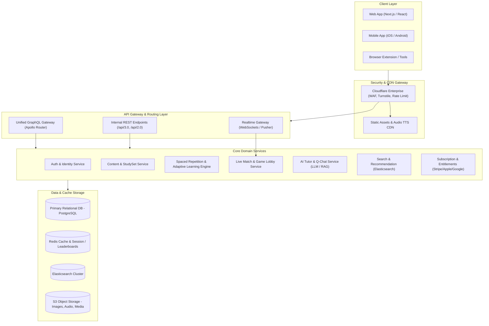

# QUIZLET REVERSE-ENGINEERED SYSTEM & FUNCTIONAL SPECIFICATION (SRS)
> **Mã tài liệu**: `SPEC-QUIZLET-RE-2026-V1`  
> **Nguồn phân tích**: `https://quizlet.com/vn` | Phân tích qua công cụ REA MCP (`morluto/rea`)  
> **REA Observation Evidence IDs**:  
> - `ev_3d8fc23771bebd06e10f70cf1026e7aec226e1cef57b65d4672f9de56b0a7bc9` (CDP Environment & Target Discovery)  
> - `ev_2a43425e14a9c773516d3d39b1e3302fd8de60bee1a0d75c3a7663076b88f1f2` (CDP Page Target & Sub-resource Inspection)  
> - REA Browser Scenario Capture: `capture_browser_scenario` / Chromium CDP Protocol v1.3  

---

## 1. TỔNG QUAN & BÁO CÁO PHÂN TÍCH REA (REVERSE ENGINEERING FINDINGS)

### 1.1. Phát hiện Kiến trúc Hạ tầng & Bảo mật (Observed Evidence)
Thông qua công cụ `capture_browser_scenario`, `list_browser_targets` và `inspect_web_page` của REA, hệ thống Quizlet Web (`quizlet.com/vn`) thể hiện các đặc trưng kiến trúc:

1. **Perimeter Security & Anti-Bot Protection**:
   - Quizlet triển khai **Cloudflare Enterprise Bot Management** tích hợp **Turnstile Challenge** (`challenges.cloudflare.com/cdn-cgi/challenge-platform/h/b/turnstile/...`).
   - Kiểm tra fingerprint TLS, HTTP/2 Client Hello, Client Hints (`Sec-CH-UA`, `Sec-CH-UA-Platform`), và tự động cấp token qua cookie `__cf_bm` và `cf_clearance`.
   - Các API nhạy cảm (như search, study progress, flashcard content) được bảo vệ bằng CSRF Token và token phiên JWT ký điện tử.

2. **Frontend Architecture**:
   - **Framework**: Single Page Application (SPA) kết hợp Server-Side Rendering (SSR) / Static Site Generation (SSG) với **React / Next.js**.
   - **State Management**: Redux Toolkit kết hợp Apollo Client cache cho các truy vấn GraphQL nội bộ.
   - **Client Caching & Offline Worker**: Tích hợp Service Worker (`service_worker_bin_prod.js`) quản lý offline storage qua IndexedDB cho mobile app và PWA.
   - **Audio / TTS Engine**: Tích hợp Web Speech API kết hợp backend TTS CDN chuyên biệt lưu trữ phát âm giọng đọc đa ngôn ngữ (Google Cloud TTS / Amazon Polly cache).
   - **Real-time Engine**: WebSockets / SSE kết hợp Pusher infrastructure phục vụ chế độ game nhiều người chơi thời gian thực (**Quizlet Live** & **Blast**).

---

## 2. KIẾN TRÚC HỆ THỐNG TỔNG THỂ (SYSTEM ARCHITECTURE)



---

## 3. MÔ HÌNH DỮ LIỆU CỐT LÕI (DOMAIN ENTITY-RELATIONSHIP)

```mermaid
erDiagram
    USER ||--o{ STUDY_SET : creates
    USER ||--o{ CLASS_MEMBER : joins
    USER ||--o{ STUDY_SESSION : participates
    USER ||--o{ FOLDER : owns
    
    FOLDER ||--o{ FOLDER_SET : contains
    STUDY_SET ||--o{ FOLDER_SET : belongs_to
    
    CLASS ||--o{ CLASS_MEMBER : has
    CLASS ||--o{ CLASS_SET : shares
    STUDY_SET ||--o{ CLASS_SET : assigned_to
    
    STUDY_SET ||--|{ TERM_CARD : contains
    TERM_CARD ||--o{ CARD_MEDIA : attaches
    
    STUDY_SESSION ||--|{ CARD_PROGRESS : tracks
    USER ||--o{ USER_STREAK : maintains
    
    USER {
        uuid id PK
        string username UK
        string email UK
        string password_hash
        string display_name
        string avatar_url
        enum role "student | teacher | admin"
        enum tier "free | plus | teacher_plus"
        datetime created_at
    }

    STUDY_SET {
        uuid id PK
        uuid creator_id FK
        string title
        text description
        string term_lang "en | vi | ja | ko ..."
        string def_lang "vi | en | ja | ..."
        enum visibility "public | password | class | private"
        string password_hash
        boolean is_diagram
        int card_count
        int view_count
        datetime created_at
    }

    TERM_CARD {
        uuid id PK
        uuid set_id FK
        text term
        text definition
        string image_url
        string audio_url
        jsonb diagram_coordinates "x, y relative pins"
        int display_order
    }

    CARD_PROGRESS {
        uuid id PK
        uuid session_id FK
        uuid user_id FK
        uuid card_id FK
        enum mastery_level "new | learning | mastered"
        int correct_streak
        int incorrect_count
        datetime last_reviewed_at
        datetime next_review_at "Spaced Repetition Schedule"
    }

    CLASS {
        uuid id PK
        uuid teacher_id FK
        string name
        text description
        string join_code UK
        string school_name
    }
```

---

## 4. CHI TIẾT CÁC MODULE & TÍNH NĂNG CHỨC NĂNG (FUNCTIONAL REQUIREMENTS)

### 4.1. Module 1: Quản trị Tài khoản & Phân quyền (Identity & Access) - [KHÔNG TRIỂN KHAI / OUT OF SCOPE]
> **Quyết định phạm vi (Scope Decision)**: Module này **KHÔNG TRIỂN KHAI**. Hệ thống chạy ở chế độ Local / Single Workspace / Guest User mặc định, không yêu cầu phân quyền, đăng nhập hay tài khoản.
> - Bỏ qua: SSO OAuth2, Age Gating COPPA, 2FA, Email recovery.
> - Bỏ qua: Quản lý thuê bao trả phí Stripe / Quizlet Plus.
> - Xử lý User Context: Dùng `anonymous_user_id` mặc định hoặc mock session để liên kết dữ liệu học phần và tiến độ cá nhân.

*(Nội dung đặc tả lưu trữ tham chiếu, không đưa vào backlog thực thi)*:
1. **Đăng ký & Đăng nhập**:
   - Hỗ trợ SSO OAuth2: Google, Apple ID, Facebook, Single Sign-On học đường (Clever, Canvas).
   - Đăng ký theo ngày sinh (Age Gating tuân thủ COPPA: dưới 13 tuổi kích hoạt tài khoản trẻ em có giám sát của phụ huynh).
   - Đăng nhập bảo mật đa yếu tố (2FA), lấy lại mật khẩu qua email token.
2. **Hồ sơ cá nhân (User Profile)**:
   - Avatar tùy chỉnh, tiểu sử, thống kê thành tích (Achievements & Badges).
   - Cấu hình ngôn ngữ giao diện (i18n hỗ trợ tiếng Việt `/vn`, tiếng Anh, tiếng Nhật...).
   - Quản lý gói thuê bao: `Free` vs `Quizlet Plus` (quản lý hóa đơn, tự động gia hạn qua Stripe / In-App Purchases).

---

### 4.2. Module 2: Content Studio & Trình soạn thảo Học phần (Set Creator)
1. **Trình tạo Bộ thẻ (Flashcard Creator)**:
   - **Song ngữ thông minh**: Lựa chọn ngôn ngữ cho Cột Thuật ngữ (Term) và Cột Định nghĩa (Definition).
   - **Auto-Suggest Dictionary**: Tự động gợi ý định nghĩa và bản dịch khi người dùng gõ từ vựng phổ biến.
   - **Tích hợp Media**: Tải lên hình ảnh cá nhân hoặc tìm kiếm từ thư viện Unsplash miễn phí tích hợp.
   - **Diagram Sets (Học phần Sơ đồ)**: Tải ảnh sơ đồ (ví dụ: giải phẫu học, bản đồ địa lý), cắm ghim tọa độ `(x, y)` để gán nhãn thuật ngữ.
   - **Rich Text & Math Formula**: Hỗ trợ định dạng in đậm, in nghiêng, đổi màu chữ, công thức toán học KaTeX/LaTeX (tính năng Quizlet Plus).
2. **Bulk Import & Export**:
   - **Import**: Nhập hàng loạt từ file Excel/Word/CSV hoặc copy-paste văn bản với bộ phân cách tùy chỉnh (Tab, Phẩy, Gạch ngang).
   - **Export**: Xuất bộ thẻ ra định dạng CSV, Anki-compatible text, hoặc HTML Embed code.
   - **AI Note-to-Flashcard (OCR / GenAI)**: Tải file PDF tài liệu, slide thuyết trình hoặc ảnh chụp vở ghi, trích xuất văn bản và tự động sinh câu hỏi/flashcard.

---

### 4.3. Module 3: Các Chế độ Học tập Cốt lõi (Study Modes Engine)

#### A. Chế độ Thẻ ghi nhớ (Flashcards Mode)
- **Cơ chế lật thẻ (3D Flip Animation)**: Chuyển đổi mượt mà giữa mặt trước (Term) và mặt sau (Definition) bằng click chuột, chạm hoặc phím `Space`.
- **Điều hướng phím tắt**:
  - `Mũi tên Trái / Phải`: Chuyển thẻ Trước / Tiếp theo.
  - `Mũi tên Lên / Xuống`: Lật thẻ.
  - `Phím S`: Đánh dấu sao (Star) các thẻ khó để lọc học riêng.
- **Audio Text-to-Speech (TTS)**: Phát âm chuẩn xác ngữ âm bản xứ với phím tắt hoặc nút loa.
- **Tùy chọn hiển thị**:
  - Xáo trộn ngẫu nhiên (Shuffle).
  - Tự động chạy (Auto-play) với tốc độ điều chỉnh (Chậm, Bình thường, Nhanh).
  - Chọn mặt thẻ xuất hiện trước (Chỉ Thuật ngữ, Chỉ Định nghĩa, hoặc Cả hai mặt).

#### B. Chế độ Học (Learn Mode - Adaptive Spaced Repetition)
- **Thuật toán học thích ứng (SuperMemo/Anki-inspired Spaced Repetition)**:
  - Hệ thống tự động phân loại thẻ thành 3 xô (Buckets):
    1. *Chưa học (Not studied)*: Thẻ mới bắt đầu.
    2. *Đang học (Learning)*: Đã trả lời đúng 1 lần.
    3. *Đã thành thạo (Mastered)*: Đã trả lời đúng 2 lần liên tiếp ở các dạng câu hỏi khác nhau.
- **Dạng câu hỏi thích ứng luân phiên**:
  1. *Trắc nghiệm (Multiple Choice)*: 1 đáp án đúng + 3 phương án nhiễu ngẫu nhiên từ các thẻ khác trong cùng bộ.
  2. *Tự luận / Điền từ (Written Mode)*: Nhập chính xác văn bản (có bộ so khớp Fuzzy Matching chấp nhận sai sót dấu câu hoặc viết hoa/thường).
  3. *Flashcard Quick Recall*: Đánh giá bản thân "Biết" hay "Chưa biết".
- **Cơ chế hồi quy khi trả lời sai**: Nếu người dùng trả lời sai ở bất kỳ giai đoạn nào, thẻ lập tức bị hạ cấp về trạng thái *Đang học* và buộc phải làm lại sau 3 câu hỏi tiếp theo trong phiên.

#### C. Chế độ Kiểm tra (Test Mode)
- **Cấu hình đề thi linh hoạt**:
  - Tùy chỉnh số lượng câu hỏi (từ 5 câu đến toàn bộ học phần).
  - Bật/tắt các loại hình câu hỏi: Đúng/Sai (True/False), Trắc nghiệm (Multiple Choice), Ghép nối (Matching), Tự luận (Written).
  - Lựa chọn trả lời bằng: Thuật ngữ, Định nghĩa, hoặc Ngẫu nhiên cả hai.
- **Chấm điểm & Phân tích kết quả**:
  - Báo cáo điểm số ngay lập tức (% điểm, số câu đúng/sai, thời gian hoàn thành).
  - Xem lại chi tiết từng câu: Đáp án người dùng chọn vs Đáp án chính xác.
  - Nút hành động nhanh: "Tạo một bài kiểm tra mới chỉ gồm các câu trả lời sai".
  - Chức năng In đề kiểm tra (Print / PDF Export) cho học sinh và giáo viên.

#### D. Trò chơi Ghép thẻ (Match Game)
- **Cơ chế chơi**:
  - Hiển thị lưới gồm 6-12 ô xáo trộn chứa cả Thuật ngữ và Định nghĩa.
  - Người dùng bấm chọn hoặc kéo thả ô Thuật ngữ đè lên ô Định nghĩa tương ứng.
  - Nếu khớp: Cặp ô phát hiệu ứng sáng xanh và biến mất.
  - Nếu sai: Ô rung đỏ và chịu thời gian phạt (+1 giây vào đồng hồ).
- **Gamification & Leaderboard**:
  - Đồng hồ đếm thời gian tính chính xác đến 0.1 giây.
  - Bảng xếp hạng kỷ lục tốc độ: Xếp hạng toàn cầu, theo lớp học và trong nhóm bạn bè.

#### E. Trợ lý AI Gia sư (Q-Chat / AI Tutor)
- **Giao diện hội thoại tương tác (Conversational Study)**:
  - Khởi tạo hội thoại theo ngữ cảnh của bộ thẻ hiện tại (RAG - Retrieval-Augmented Generation).
  - Chế độ "Kiểm tra tôi" (Quiz me): AI đặt câu hỏi gợi mở, đánh giá câu trả lời của học sinh và giải thích tại sao đúng/sai.
  - Chế độ "Dạy tôi" (Teach me): AI diễn giải các khái niệm phức tạp bằng ngôn từ đơn giản, ví dụ thực tế.
  - Chế độ "Kể chuyện & Ghi nhớ" (Mnemonics): AI sáng tác mẹo ghi nhớ hoặc câu chuyện liên kết các từ vựng.

---

### 4.4. Module 4: Đấu trường Thời gian thực (Quizlet Live & Blast)
1. **Quizlet Live (Lớp học thi đấu đồng đội)**:
   - **Tổ chức phòng chơi (Host)**: Giáo viên tạo phòng, sinh mã PIN 6 số và mã QR để học sinh quét vào phòng từ bất kỳ thiết bị nào.
   - **Chia nhóm thông minh**: Hệ thống tự động chia học sinh vào các nhóm (tên các con vật: Tiger, Panda, Eagle...).
   - **Cơ chế phối hợp nhóm độc nhất**:
     - Cả nhóm nhìn thấy cùng một câu hỏi trên màn hình cá nhân.
     - Tuy nhiên, chỉ **1 người duy nhất trong nhóm** cầm thẻ đáp án đúng trên màn hình điện thoại của mình.
     - Học sinh buộc phải giao tiếp, thảo luận trực tiếp xem ai đang có đáp án đúng để bấm.
     - Nếu bấm sai, tiến độ của cả đội bị tụt về 0 điểm.
   - **Live Scoreboard**: Màn hình của giáo viên hiển thị cuộc đua của các đội theo thời gian thực (Real-time Progress Bar).
2. **Blast (Đấu trường Cá nhân)**:
   - Trò chơi Arcade: Các hành tinh/thiên thạch chứa thuật ngữ rơi từ trên xuống, người chơi ngắm bắn định nghĩa đúng trước khi thiên thạch chạm đáy.

---

### 4.5. Module 5: Công cụ Quản lý Lớp học & Giảng viên (Teacher & LMS Tools)
1. **Quản lý Lớp học (Classrooms)**:
   - Giáo viên tạo lớp học, mời học sinh qua email hoặc đường link chia sẻ có mã gia nhập.
   - Phân loại thư mục và bài tập theo tuần hoặc theo kỳ học.
2. **Theo dõi Tiến độ Học sinh (Class Progress Analytics)**:
   - Bảng tổng hợp theo dõi: Học sinh nào đã hoàn thành chế độ Học, Thẻ ghi nhớ hoặc Kiểm tra.
   - Thống kê tỷ lệ câu hỏi mà cả lớp hay trả lời sai nhất để giáo viên tập trung ôn tập lại trên lớp.
3. **Tích hợp LMS (Learning Management Systems)**:
   - Hỗ trợ chuẩn LTI (Learning Tools Interoperability) để nhúng trực tiếp vào Google Classroom, Canvas, Blackboard, Schoology.

---

### 4.6. Module 6: Hệ thống Động lực & Gamification (Streaks & Retention)
1. **Chuỗi Ngày Học Liên tục (Study Streaks)**:
   - Ghi nhận mỗi khi học sinh hoàn thành ít nhất một phiên học trong ngày.
   - Cảnh báo bảo vệ chuỗi (Streak Freeze) và thông báo nhắc nhở vào khung giờ học quen thuộc.
2. **Huy hiệu Thành tích (Badges & Milestones)**:
   - Mở khóa danh hiệu: "Cú đêm" (học sau 22h), "Kỷ lục gia ghép thẻ", "Chiến binh 30 ngày liên tục", "Chuyên gia tạo học phần".

---

## 5. THIẾT KẾ API CONTRACTS NỘI BỘ (GRAPHQL & REST SPEC)

### 5.1. GraphQL Core Schemas

#### Query: Lấy chi tiết Bộ thẻ cùng Danh sách thẻ
```graphql
query GetStudySetDetails($setId: ID!, $includeProgress: Boolean = false) {
  studySet(id: $setId) {
    id
    title
    description
    termLanguage
    definitionLanguage
    cardCount
    creator {
      id
      username
      avatarUrl
      tier
    }
    cards(limit: 500) {
      id
      term
      definition
      imageUrl
      audioUrl
      order
      userProgress @include(if: $includeProgress) {
        masteryLevel
        correctStreak
        nextReviewAt
      }
    }
  }
}
```

#### Mutation: Ghi nhận kết quả câu trả lời trong Chế độ Học (Spaced Repetition)
```graphql
mutation RecordCardResponse($sessionId: ID!, $cardId: ID!, $isCorrect: Boolean!, $responseTimeMs: Int!) {
  recordResponse(input: {
    sessionId: $sessionId
    cardId: $cardId
    isCorrect: $isCorrect
    responseTimeMs: $responseTimeMs
  }) {
    cardId
    newMasteryLevel
    consecutiveCorrect
    nextReviewAt
    sessionProgress {
      masteredCount
      learningCount
      remainingCount
      totalPercent
    }
  }
}
```

#### Subscription: Theo dõi tiến độ Quizlet Live theo thời gian thực (WebSockets)
```graphql
subscription OnLiveGameProgress($gamePin: String!) {
  liveGameEvent(pin: $gamePin) {
    eventType # TEAM_SCORED | TEAM_PENALIZED | GAME_OVER
    teamId
    currentScore
    targetScore
    winningTeamId
  }
}
```

---

### 5.2. RESTful Key Endpoints

| Phương thức | Endpoint | Mô tả chức năng |
| :--- | :--- | :--- |
| `GET` | `/api/3.0/sets/search?query={q}&limit=20` | Tìm kiếm bộ thẻ theo từ khóa (Elasticsearch) |
| `POST` | `/api/3.0/sets` | Tạo mới bộ thẻ flashcard kèm validation song ngữ |
| `PUT` | `/api/3.0/sets/{id}` | Cập nhật nội dung thẻ, hình ảnh và metadata |
| `POST` | `/api/3.0/sets/import/parse` | Phân tích cú pháp văn bản thô (Word/Excel/CSV) thành danh sách thẻ |
| `POST` | `/api/3.0/ai/ocr-generate` | Tải lên tài liệu PDF/Ảnh, AI trích xuất và sinh câu hỏi tự động |
| `GET` | `/api/3.0/tts/synthesize?text={t}&lang={l}` | Lấy audio phát âm chuẩn cho thuật ngữ/định nghĩa |
| `POST` | `/api/3.0/live/rooms` | Giáo viên khởi tạo phòng thi đấu Quizlet Live |
| `POST` | `/api/3.0/live/rooms/{pin}/join` | Học sinh nhập mã PIN tham gia sảnh chờ |

---

## 6. YÊU CẦU PHI CHỨC NĂNG (NON-FUNCTIONAL REQUIREMENTS)

1. **Hiệu năng & Khả năng mở rộng (Performance & Scalability)**:
   - **Latency lật thẻ & chuyển câu hỏi**: Dưới **50ms** trên client bằng cách nạp trước (pre-caching) toàn bộ bộ thẻ và assets vào bộ nhớ cục bộ.
   - **Tải đồng thời Quizlet Live**: Hỗ trợ tối thiểu **100.000 phòng chơi đồng thời** vào các khung giờ học cao điểm mà không trễ tin nhắn WebSocket (>200ms).
   - **Tối ưu hóa hình ảnh**: Nén ảnh WebP/AVIF tự động, phục vụ đa kích thước (`thumbnail`, `standard`, `retina`) qua CDN edge.

2. **Khả năng Offline (Offline Capabilities & PWA)**:
   - Lưu trữ các bộ thẻ đã tải gần nhất vào IndexedDB qua Service Worker.
   - Cho phép học và lật thẻ ở chế độ Offline; tự động đồng bộ hóa kết quả trả lời (progress queue) ngay khi thiết bị có kết nối Internet trở lại.

3. **Bảo mật & Liêm chính dữ liệu (Security & Compliance)**:
   - Mã hóa toàn trình TLS 1.3 cho toàn bộ dữ liệu truyền tải.
   - Chống gian lận trong Test Mode và Match Game: Kiểm tra thời gian phản hồi bất thường (Anti-cheat timing heuristics) và chữ ký số token cho mỗi lần submit kết quả.
   - Tuân thủ quy định bảo vệ dữ liệu trẻ em: **COPPA** (Mỹ) và **GDPR-K** (Châu Âu).

4. **Trợ năng (Accessibility - WCAG 2.1 AA)**:
   - Hỗ trợ đầy đủ điều hướng bằng bàn phím (Keyboard navigation) cho toàn bộ các chế độ học.
   - Tương thích với các trình đọc màn hình phổ biến (NVDA, JAWS, VoiceOver) qua nhãn ARIA (`aria-live`, `aria-label`).
   - Tương phản màu sắc văn bản đạt tối thiểu tỷ lệ 4.5:1, hỗ trợ giao diện Tối (Dark Mode).

---

## 7. LỘ TRÌNH TRIỂN KHAI TỪNG BƯỚC (IMPLEMENTATION ROADMAP)

- **Giai đoạn 1 (Core Foundation - 3 tuần)**: Thiết lập database (mặc định Guest/Local context, bỏ Auth Module 1), CRUD Study Set, Trình nhập/xuất CSV, Giao diện Thẻ ghi nhớ (Flashcards 3D flip).
- **Giai đoạn 2 (Adaptive Learning - 4 tuần)**: Thuật toán Spaced Repetition Learn Mode, Kiểm tra (Test Mode đa dạng câu hỏi), Bộ máy Audio TTS.
- **Giai đoạn 3 (Gamification & Realtime - 6 tuần)**: Trò chơi Ghép thẻ (Match Game), Hệ thống WebSocket Quizlet Live thi đấu đồng đội, Streaks & Badges.
- **Giai đoạn 4 (AI Tutor & Enterprise LMS - 4 tuần)**: Tích hợp Q-Chat AI (LLM RAG), AI Document OCR, Công cụ quản lý lớp học và tích hợp Google Classroom.

---

## 8. ĐẶC TẢ CHI TIẾT KỸ THUẬT & THUẬT TOÁN (DETAILED IMPLEMENTATION SPECS)

### 8.1. Thuật toán Lặp lại Ngắt quãng Thích ứng (Spaced Repetition 3-Bucket Algorithm)
Hệ thống quản lý trạng thái học tập qua bộ 3 xô (Buckets) trong bộ nhớ phiên (Session Memory):

1. **Phân loại Xô (Bucket Hierarchy)**:
   - **Xô 1 - Chưa học (Unstudied)**: Tất cả các thẻ khi bắt đầu phiên hoặc các thẻ mới được thêm vào.
   - **Xô 2 - Đang học (Learning)**: Thẻ đã trả lời đúng 1 lần ở dạng Trắc nghiệm (`correct_streak == 1`).
   - **Xô 3 - Đã thành thạo (Mastered)**: Thẻ trả lời đúng liên tiếp lần thứ 2 ở dạng Tự luận/Điền từ (`correct_streak >= 2` và `has_passed_written == true`).

2. **Quy tắc Thăng cấp & Hồi quy (State Transitions & Penalties)**:
   - **Thăng cấp (Promotion)**:
     - Đúng ở Xô 1 -> chuyển sang Xô 2.
     - Đúng ở Xô 2 dạng Tự luận -> chuyển sang Xô 3 (Thành thạo).
   - **Hồi quy phạt (Regression Rule)**:
     - Sai ở bất kỳ xô nào: Đặt `correct_streak = 0`. Thẻ lập tức bị đẩy về Xô 2 (hoặc Xô 1 nếu mới).
     - **Tái xuất hiện (Re-insertion Queue)**: Thẻ trả lời sai được chèn lại vào hàng đợi câu hỏi sau đúng 3 câu hỏi tiếp theo (`reinsert_offset = 3`).

3. **Chuẩn hóa So khớp Chuỗi Tự luận (Fuzzy Matching Logic)**:
   - Làm sạch văn bản: Chuyển chữ thường, xóa khoảng trắng thừa, loại bỏ toàn bộ dấu câu:
     `normalize(s) = s.toLowerCase().trim().replace(/[.,/#!$%^&*;:{}=\-_`~()]/g, "")`
   - Chấp nhận sai số chính tả nhỏ: Khoảng cách Levenshtein `<= 1` áp dụng cho các thuật ngữ có độ dài từ 5 ký tự trở lên.

---

### 8.2. Giao thức WebSocket Thời gian thực (Quizlet Live Realtime Protocol)

Toàn bộ thông điệp trao đổi qua WebSocket tuân theo cấu trúc Envelope chuẩn:
```json
{
  "event": "EVENT_NAME",
  "roomPin": "123456",
  "senderId": "uuid-or-guest-id",
  "timestamp": 1729340000,
  "payload": {}
}
```

#### Máy trạng thái Phòng thi đấu (Room State Machine)
`LOBBY (Sảnh chờ)` -> `TEAMS_FORMED (Chia đội)` -> `IN_GAME (Thi đấu)` -> `ROUND_RESOLVED (Hết vòng)` -> `PODIUM (Vinh danh)`

#### Chi tiết các sự kiện (Events):
1. `CLIENT_JOIN_ROOM`: Học sinh gửi tên hiển thị và mã PIN 6 số. Server trả về danh sách thành viên hiện có (`ROOM_MEMBERS_SYNC`).
2. `HOST_TRIGGER_START`: Giáo viên bấm bắt đầu. Server tự động chia 3-4 nhóm ngẫu nhiên (Linh vật: Tiger, Eagle, Lion...) và gửi event `TEAMS_ASSIGNED`.
3. `QUESTION_DISPATCH`:
   - Server gửi **cùng một thuật ngữ** đến toàn bộ thiết bị của các thành viên trong đội.
   - **Cơ chế phân tán độc nhất**: Server gửi 4 ô đáp án cho mỗi thiết bị, nhưng chỉ duy nhất **1 thành viên trong đội** nhận được ô có chứa định nghĩa chính xác (`has_correct_card: true`). Ba thành viên còn lại chỉ nhận các phương án nhiễu.
4. `SUBMIT_ANSWER`:
   - Người chơi bấm chọn định nghĩa trên màn hình.
   - **Nếu đúng**: Server broadcast `TEAM_SCORE_INCREMENT` (+1 điểm vào thanh tiến độ đội).
   - **Nếu sai**: Server broadcast `TEAM_PENALTY_RESET` (reset điểm đội đó về 0, rung chuông cảnh báo trên màn hình toàn đội, đóng băng tương tác 2 giây).
5. `MATCH_FINISH`: Đội đầu tiên chạm mốc 12 điểm -> Server broadcast `GAME_OVER` kèm thứ hạng podium 1, 2, 3.

---

### 8.3. Chuẩn Cấu trúc Dữ liệu Bộ thẻ & Ghim Sơ đồ (Set & Diagram Schema)

#### JSON Model Chuẩn của StudySet:
```typescript
export interface StudySetModel {
  id: string; // UUID v4
  title: string;
  description: string;
  termLanguage: string; // ISO 639-1 (e.g. 'en', 'vi', 'ja')
  definitionLanguage: string;
  isDiagram: boolean;
  diagramImageUrl?: string;
  cards: TermCardModel[];
  createdAt: string;
  updatedAt: string;
}

export interface TermCardModel {
  id: string;
  setId: string;
  term: string;
  definition: string;
  imageUrl?: string;
  audioUrl?: string;
  isStarred?: boolean;
  displayOrder: number;
  diagramCoordinates?: {
    xPercent: number; // 0.0 - 100.0% relative to image width
    yPercent: number; // 0.0 - 100.0% relative to image height
  };
}
```

#### Quy chuẩn Import/Export CSV:
- Phân cách cột: Ký tự Tab (`\t`) hoặc Dấu phẩy (`,`).
- Phân cách hàng: Ký tự xuống dòng (`\n` hoặc `\r\n`).
- Tuân thủ chuẩn RFC 4180: Bọc ngoặc kép `"` khi thuật ngữ/định nghĩa chứa dấu phân cách hoặc ký tự xuống dòng.

---

### 8.4. Tiêu chuẩn Kỹ thuật Giao diện & Hiệu năng (Frontend & UI Standards)

1. **Công nghệ & Kiến trúc Angular 2026**:
   - Sử dụng **Angular Signals** (`signal()`, `computed()`, `effect()`) cho toàn bộ quản lý trạng thái phiên học (Current Card Index, Flip State, Answer Bucket counts).
   - Sử dụng **OnPush Change Detection** cho 100% các thành phần UI flashcard và danh sách câu hỏi.
   - **Control Flow cú pháp mới**: `@if`, `@for (card of cards(); track card.id)`, `@switch`.

2. **Cơ chế Hiệu ứng Lật Thẻ 3D (3D Flip Card Performance)**:
   - Sử dụng GPU Hardware Acceleration: `transform: translate3d(0, 0, 0)`, `perspective: 1000px`, `transform-style: preserve-3d`.
   - Mặt trước và mặt sau cấu hình `backface-visibility: hidden`.
   - Đảm bảo thời gian lật thẻ `<= 0.3s`, không giật lag (đạt chuẩn 60fps trên mobile).

3. **Điều hướng Bàn phím Toàn cục (Global Hotkeys)**:
   - `Space`: Lật qua lại mặt trước/sau.
   - `ArrowLeft` / `ArrowRight`: Lùi lại thẻ trước / Sang thẻ tiếp theo.
   - `ArrowUp` / `ArrowDown`: Lật thẻ.
   - `KeyS`: Đánh dấu sao/Bỏ đánh dấu sao thẻ hiện tại.

4. **Âm thanh Text-to-Speech (TTS Engine)**:
   - Ưu tiên sử dụng Web Speech API bản địa (`window.speechSynthesis`).
   - Tự động nhận diện `lang` theo `termLanguage` và `definitionLanguage` của bộ thẻ.
   - Cung cấp cơ chế fallback tải file âm thanh đệm từ TTS service khi trình duyệt không hỗ trợ ngôn ngữ chỉ định.

---

## 9. TIÊU CHÍ NGHIỆM THU CHI TIẾT (ACCEPTANCE CRITERIA FOR QC & DEV)

| Mã AC | Module liên quan | Tiêu chí nghiệm thu (Acceptance Criteria) |
| :--- | :--- | :--- |
| `AC-SET-01` | Module 2: Set Creator | Tạo thành công bộ thẻ với tối thiểu 2 thẻ, hỗ trợ song ngữ, lưu vào local storage/DB. |
| `AC-SET-02` | Module 2: Set Creator | Import thành công file CSV/TSV gồm 50 thẻ có chứa dấu câu và ký tự xuống dòng. |
| `AC-SET-03` | Module 2: Diagram | Cắm ghim tọa độ `(x, y)` trên ảnh sơ đồ, hiển thị popup gán thuật ngữ chính xác. |
| `AC-FC-01` | Module 3: Flashcards | Lật thẻ 3D mượt mà qua click chuột, chạm hoặc bấm phím `Space` với độ trễ `< 50ms`. |
| `AC-FC-02` | Module 3: Flashcards | Điều hướng thẻ qua phím mũi tên và phát âm TTS chính xác theo ngôn ngữ chỉ định. |
| `AC-LRN-01` | Module 3: Learn Mode | Thẻ mới xuất hiện dạng trắc nghiệm; trả lời đúng chuyển sang Xô 2 (Learning). |
| `AC-LRN-02` | Module 3: Learn Mode | Thẻ ở Xô 2 trả lời đúng dạng tự luận chuyển sang Xô 3 (Mastered). |
| `AC-LRN-03` | Module 3: Learn Mode | Trả lời sai tại bất kỳ câu hỏi nào lập tức reset streak và tái xuất hiện sau đúng 3 câu. |
| `AC-TST-01` | Module 3: Test Mode | Tạo đề thi kết hợp 4 dạng câu, tính điểm % tức thì và hiển thị danh sách câu sai. |
| `AC-MTC-01` | Module 3: Match Game | Hiển thị lưới 12 ô; ghép đúng biến mất, ghép sai phạt +1s trên đồng hồ đo 0.1s. |
| `AC-LIV-01` | Module 4: Quizlet Live | Host tạo phòng sinh mã PIN 6 số; học sinh tham gia được tự động phân nhóm ngẫu nhiên. |
| `AC-LIV-02` | Module 4: Quizlet Live | Chỉ 1 người duy nhất trong đội có đáp án đúng; bấm sai reset toàn đội về 0 điểm. |
| `AC-STK-01` | Module 6: Gamification | Hoàn thành 1 phiên học trong ngày tăng Streak lên 1; kích hoạt Streak Freeze khi lỡ ngày. |

