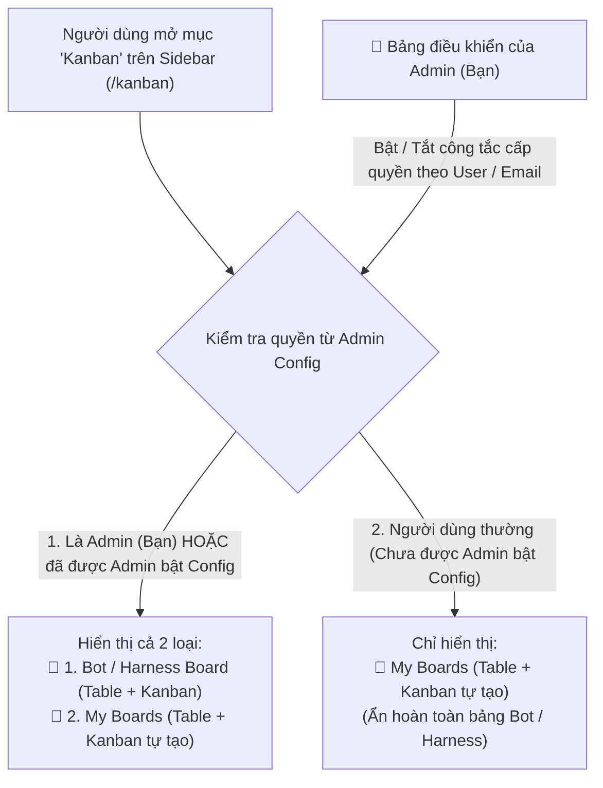

# Đặc Tả Kỹ Thuật: Hệ Thống Quản Lý Tác Vụ Kép (Table & Kanban) — Phân Quyền Admin Cho Bot Harness & Bảng Cá Nhân

> **Dự án**: Aevum (`projects/aevum`) & Harness Framework (`tools/harness_manager.py`)  
> **Phạm vi**: Frontend Core (`@affine/core`), Admin Access Control Gate, Workspace Storage & BlockSuite Data-View (`table` + `kanban`)  
> **Ngày cập nhật**: 2026-10-18  
> **Trạng thái**: Chờ duyệt thực thi (Ready for Execution)

---

## 1. Cơ Chế Phân Quyền Qua Admin (Admin Config Gate)

Theo đúng yêu cầu của bạn: **Bảng 🤖 Bot / Harness Kanban không hiển thị tràn lan cho mọi người dùng**, mà được kiểm soát chặt chẽ bởi **Admin (bạn)**:

### Quy tắc hiển thị & kiểm soát của Admin:
1. **Mặc định với người dùng thường (`botHarnessEnabled = false`)**:
   - Khi bấm vào mục **`Kanban`** trên Sidebar, họ **chỉ nhìn thấy bảng cá nhân (`My Boards` — Table & Kanban)** do chính họ tự tạo trong Workspace của họ.
   - Tab **🤖 Bot / Harness Board** hoàn toàn ẩn, người dùng thường không biết và không truy cập được.
2. **Khi được Admin (bạn) bật Config (`botHarnessEnabled = true`)**:
   - Chỉ khi tài khoản Admin (bạn, ví dụ `admin@aevum.io` / `baoltb@aevum.app`) bật công tắc cấp quyền **`Enable Bot / Harness Kanban`** cho User/Email hoặc Workspace đó, thì giao diện của người đó mới xuất hiện thêm phân khu **🤖 Bot / Harness Board**.
3. **Bảng Quản Trị Quyền Truy Cập Dành Riêng Cho Bạn (`Admin Access Config Modal`)**:
   - Khi đăng nhập bằng tài khoản **Admin (bạn)**, trên góc phải của trang Kanban sẽ có nút **`⚙️ Admin Config`**.
   - Trong **`⚙️ Admin Config`**, bạn có thể:
     - Xem danh sách người dùng / email trong hệ thống.
     - Bật / tắt công tắc **`Cho phép hiển thị Bot / Harness Kanban`** cho từng người dùng cụ thể.
     - Cấu hình nguồn dữ liệu Harness cho người dùng được cấp quyền.

---

## 2. Chi Tiết 2 Phân Khu Chức Năng (Cả 2 Đều Có `Table` & `Kanban`)

### 🤖 Loại 1: Bảng Cho Bot — Quản Lý Các Profile Bằng Harness (`Bot / Harness Board`)
*(Chỉ hiển thị cho bạn (Admin) và những người dùng được bạn bật Config)*
- **Quản lý 10 Agent Profiles từ [`tools/harness_manager.py`](file:///Users/bao312/Desktop/Room_Agent/tools/harness_manager.py#L49-L60)**:
  - `Supervisor`, `Lead`, `Peer`, `QC`, `Lead BA`, `Peer BA`, `Lead design`, `Peer Design`, `Lead Dev`, `Peer Dev`.
- **Chuyển đổi tức thì 2 dạng hiển thị (`Table View` ↔ `Kanban View`)**:
  1. **Dạng Kanban**:
     - *Gom cột theo Trạng thái (`Group by State`)*: `New` ➔ `Accepted` ➔ `Active` ➔ `Blocked` ➔ `Resolved` ➔ `Closed`.
     - *Gom cột theo Bot Profile (`Group by Bot`)*: Mỗi cột là 1 Bot (`Supervisor`, `Lead`, `Peer`, `QC`...) để nhìn ngay từng Bot đang xử lý những task nào; kéo thả thẻ qua lại để đổi trạng thái hoặc bàn giao task giữa các Bot.
  2. **Dạng Table**:
     - Hiển thị bảng danh sách chi tiết (`Work Item ID`, `Title`, `Type`: `Epic/Feature/Task/Bug/Testcase`, `State`, `Assigned Profile (Bot)`, `Parent ID`, `Updated At`).
     - Hỗ trợ lọc theo từng Bot Profile, lọc theo loại Work Item, tìm kiếm nhanh và tạo mới Task giao cho Bot.

---

### 👤 Loại 2: Bảng Cá Nhân Tự Tạo (`My Boards`)
*(Hiển thị cho tất cả người dùng trong phạm vi Workspace riêng của từng người)*
- **Cô lập 100% theo `workspaceId`**: Ai tạo bảng nào thì chỉ lưu và hiển thị trong Workspace của người đó.
- **2 Dạng hiển thị (`Table View` ↔ `Kanban View`)**:
  - Sử dụng trực tiếp khối Database (`affine:database`) của Aevum BlockSuite ([`KanbanSingleView`](file:///Users/bao312/Desktop/Room_Agent/projects/aevum/blocksuite/affine/data-view/src/view-presets/kanban/kanban-view-manager.ts#L69-L458)).
  - Bấm **`+ New Board`** để tạo bảng mới có sẵn cả 2 tab **Table View** và **Kanban View**, tự do thêm/sửa cột thuộc tính (`Status`, `Priority`, `Due Date`, `Progress`, `Tags`...) và kéo thả thẻ công việc.

---

## 3. Kế Hoạch Thực Thi 4 Bước

| Bước | Hạng mục công việc | File tác động |
| :--- | :--- | :--- |
| **Bước 1** | **Thêm mục `Kanban` lên thanh Sidebar trái** (ngay dưới `Journals`) và đăng ký route `/kanban` | `packages/frontend/core/src/components/root-app-sidebar/kanban-button.tsx`, [`root-app-sidebar/index.tsx`](file:///Users/bao312/Desktop/Room_Agent/projects/aevum/packages/frontend/core/src/components/root-app-sidebar/index.tsx#L213-L216), [`workbench-router.ts`](file:///Users/bao312/Desktop/Room_Agent/projects/aevum/packages/frontend/core/src/desktop/workbench-router.ts#L40-L44) |
| **Bước 2** | **Xây dựng cổng phân quyền Admin (`Admin Config Gate`) & API Harness**: Kiểm tra tài khoản Admin / danh sách user được Admin bật config (`botHarnessEnabled`), kèm hộp thoại `⚙️ Admin Config` để bạn bật/tắt quyền cho từng người dùng | `packages/frontend/core/src/desktop/pages/workspace/kanban/admin-config-modal.tsx` |
| **Bước 3** | **Xây dựng phân khu `🤖 Bot / Harness Board` (Table + Kanban)**: Chỉ hiện khi là Admin hoặc được Admin bật config; quản lý 10 Agent Profiles & Work Items từ [`tools/harness_manager.py`](file:///Users/bao312/Desktop/Room_Agent/tools/harness_manager.py#L49-L60) | `packages/frontend/core/src/desktop/pages/workspace/kanban/harness-board.tsx` |
| **Bước 4** | **Xây dựng phân khu `👤 My Boards` (Table + Kanban tự tạo)**: Tạo và quản lý các bảng BlockSuite Database (có sẵn cả `Table View` & `Kanban View`) của riêng từng người dùng/Workspace | `packages/frontend/core/src/desktop/pages/workspace/kanban/index.tsx` |

---

## 4. Tiêu Chí Nghiệm Thu (Acceptance Criteria)

- **AC-1 (Admin Gate)**: Người dùng thường chưa được Admin bật config khi vào `/kanban` chỉ thấy bảng cá nhân (`My Boards`), hoàn toàn không thấy `Bot / Harness Board`.
- **AC-2 (Admin Control Panel)**: Tài khoản Admin (bạn) luôn thấy cả 2 bảng (`Bot / Harness Board` + `My Boards`) và có nút `⚙️ Admin Config` để bật/tắt quyền truy cập bảng Bot/Harness cho bất kỳ người dùng nào.
- **AC-3 (Bot / Harness Table & Kanban)**: Chuyển đổi mượt giữa `Table View` và `Kanban View` (gom theo `State` hoặc gom theo 10 `Agent Profiles`), kéo thả cập nhật trạng thái/Bot trực tiếp.
- **AC-4 (Personal Custom Table & Kanban)**: Người dùng tự tạo bảng mới trong `My Boards`, có sẵn cả 2 tab `Table` và `Kanban` của BlockSuite, cô lập theo từng `workspaceId`.
