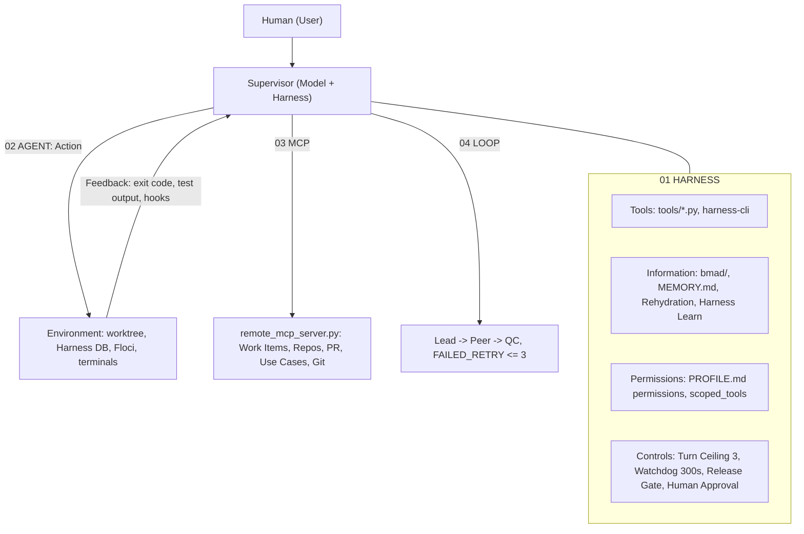

# Spec: 12 Khái Niệm Nền Tảng AI Agent ánh xạ vào Room_Agent

> **Phạm vi**: Harness · Agent · MCP · Loop Engineering · RAG · Multi-Agent · Memory · Evals · Context Engineering · Permission Gates · Computer Use & GUI · Observability & Trace
> **Mã spec**: `ARCH-SPEC-AI-AGENT-4-CONCEPTS-2026-V1` (rev 3 — Phần 2: khái niệm 05–08; Phần 3: khái niệm 09–12)
> **Ngày**: 2026-10-26
> **Trạng thái**: Draft — chờ Supervisor duyệt
> **Nguồn khái niệm**: Bộ slide "Bản Đồ Vector Khái Niệm AI Agent". P.1: 01 Harness, 02 Agent, 03 MCP, 04 Loop Engineering (+ slide tổng). P.2: 05 RAG, 06 Multi-Agent, 07 Memory, 08 Evals. P.3: 09 Context Engineering, 10 Permission Gates, 11 Computer Use & GUI, 12 Observability & Trace.
> **Phương pháp**: Đọc source repo (static) + dịch ngược binary `scripts/bin/harness-cli` bằng **REA `rea-agents@6.5.0`** (skill `rea-reverse-engineering` / `reverse-engineer-anything`).
> **Quy ước bằng chứng**: `[OBS]` = quan sát trực tiếp trong source/binary · `[INF]` = suy luận · `[UNK]` = chưa xác định được.

---

## 0. Bản Đồ Vector Tổng (Slide "Trọn Bộ Vector")

| # | Khái niệm | Ý nghĩa một dòng | Thành phần Room_Agent chịu trách nhiệm |
|---|---|---|---|
| 01 | **Harness** | Khung xương & 4 gọng kìm bao quanh Model | `profiles/<role>/PROFILE.md`, `tools/`, `bmad/`, `harness-cli`, `slppc_flow_guard.py`, `zombie_reaper.py` |
| 02 | **Agent** | Vòng lặp khép kín với môi trường | Supervisor + ephemeral Lead/Peer/QC chạy trong Orca/Paseo/Hermes terminal |
| 03 | **MCP** | Cổng sạc USB-C vạn năng nối Model ↔ Tools/Data | `tools/remote_mcp_server.py` (stdio JSON-RPC 2.0) |
| 04 | **Loop Engineering** | Chia nhỏ vòng lặp, tự kiểm, tự sửa có trần | `scripts/run_pipeline.py`, `AgentHandoffEnvelope`, `evos_engine.py`, QC gate |
| 05 | **RAG** | Truy xuất đúng Top-3 đoạn trích dẫn trước khi Model trả lời | `tools/query_reader.py`, `tools/tds_search.py`, `tools/harness_learning_search.py` |
| 06 | **Multi-Agent** | Chia để trị: Leader + Coder + Tester + Reviewer, giao tiếp structured messages | Supervisor/Lead · Peer · QC · Lead review; `AgentHandoffEnvelope` |
| 07 | **Memory** | 3 tầng Working / Short-term / Long-term | `agent_context_manager.py` (compact + 3-Tier Hydration), `bmad/rooms/*/latest_handoff.md`, `harness_experience` |
| 08 | **Evals** | Golden Dataset + LLM-as-a-Judge + Guardrails → PASS 98.5% | `tools/evos_engine.py`, `anti_leak_sentinel.py`, `slppc_flow_guard.py` |
| 09 | **Context Engineering** | Nén & cắt tỉa, chỉ nạp "golden tokens" | RTK (`.rtk/`, `rtk_profile_env.sh`), auto-compact, 3-Tier Hydration |
| 10 | **Permission Gates** | Read tự do, Write/High-risk dừng xin quyền (HITL) | `PROFILE.md permissions`, `harness_manager.update_state`, `cli/orca-review`, Paseo `modeId` |
| 11 | **Computer Use & GUI** | AI thao tác chuột/phím/màn hình cho app không có API | Orca `computer` CLI + `Orca Computer Use.app`, `agent-browser`, chrome-devtools MCP |
| 12 | **Observability & Trace** | Tracing spans: latency + token từng bước | bảng `trace` Harness DB, `agent_heartbeat.py`, `agent_progress.py`, banners, `harness_dashboard.py` |



---

## 1. HARNESS — Khung xương & 4 gọng kìm (Slide 01)

### 1.1 Định nghĩa
Harness là toàn bộ phần **không phải Model** bao quanh Model: **Tools** (tay chân), **Information** (ngữ cảnh), **Permissions** (được làm gì), **Controls** (dừng/duyệt khi nào). Đầu ra (báo cáo, email, source code) chỉ được phát hành sau một **cổng xác nhận của con người** ("🔒 Gửi nhé? [Gửi] [Huỷ]").

### 1.2 Yêu cầu
| ID | Yêu cầu | Mức |
|---|---|---|
| HRN-01 | Mỗi vai trò phải có **danh sách tool giới hạn** (`scoped_tools`) khai báo trong `profiles/<role>/PROFILE.md`. | MUST |
| HRN-02 | Ngữ cảnh nạp cho agent phải đi qua **3-Tier Hydration** (Profile/Identity/Soul → Task active trên Harness DB → Latest handoff + Memory). | MUST |
| HRN-03 | Quyền (`permissions`) phải được **cưỡng chế bằng code** tại điểm chuyển trạng thái, không chỉ khai báo. | MUST |
| HRN-04 | Mọi hành động có tác động ra ngoài (merge, push, gửi mail/PR) phải qua **Human Approval Gate**. | MUST |
| HRN-05 | Harness phải có **Controls cơ học**: trần vòng lặp, timeout, circuit breaker, release gate. | MUST |
| HRN-06 | Dữ liệu nhạy cảm bị chặn trước khi ra khỏi Harness (`anti_leak_sentinel.py`, gitleaks). | MUST |

### 1.3 Ánh xạ hiện trạng
| Gọng kìm | Hiện thực | Bằng chứng |
|---|---|---|
| **Tools** | ~38 CLI Python trong `tools/`; `scoped_tools` từng profile; binary Rust `harness-cli` | `[OBS]` [lead/PROFILE.md](../../profiles/lead/PROFILE.md), [qc/PROFILE.md](../../profiles/qc/PROFILE.md) |
| **Information** | `build_rehydration_prompt()` đọc `profiles/<role>/{PROFILE,IDENTITY,SOUL,MEMORY}.md` + Harness DB + handoff; `bmad/` (rooms, adrs, wiki); Harness Learn (`harness_experience`) | `[OBS]` [agent_context_manager.py#L262-L395](../../tools/agent_context_manager.py#L262-L395) |
| **Permissions** | Khối `permissions:` trong PROFILE.md (`can_code`, `can_close_task`…); rào chặn Peer đóng task trong `HarnessManager.update_state` | `[OBS]` [harness_manager.py#L534-L560](../../tools/harness_manager.py#L534-L560) |
| **Controls** | Turn Ceiling `retry_count <= 3`; Watchdog `DEFAULT_TIMEOUT_S = 300`; circuit breaker; EVOS Release Gate; `cli/orca-review approve/reject` | `[OBS]` [slppc_flow_guard.py#L136-L175](../../tools/slppc_flow_guard.py#L136-L175), [zombie_reaper.py#L62](../../tools/zombie_reaper.py#L62), [evos_engine.py#L36](../../tools/evos_engine.py#L36) |
| **Human Gate** | Orca Review Gate: QC PASS → `./cli/orca-review approve <id>` hoặc `reject --reason` | `[OBS]` [orca-review](../../cli/orca-review) → `tools/orca_worktree_manager.py` |

### 1.4 Bằng chứng REA cho `harness-cli` (lõi Harness DB)
Lệnh: `npx -y rea-agents@6.5.0 inspect-rust-binary scripts/bin/harness-cli --json`

| Thuộc tính | Giá trị | Loại |
|---|---|---|
| Evidence ID | `ev_15001772d54149fbc0c4f875c76fc6854a9c16d03bd4b3ffa0431948b8b6a7fd` | `[OBS]` |
| SHA-256 | `66eb9e33ac0f4b4cb26d5dc175eb8b63debebb00935639aedae5d231fd272004` (7,137,256 bytes) | `[OBS]` |
| Định dạng | ELF 64-bit, x86-64, little-endian (Linux) — **không chạy native trên macOS** | `[OBS]` |
| `.dep-v0` (cargo-auditable) | Không có → REA không liệt kê được dependency chính thức | `[OBS]` |
| rustc commit | `8bab26f4f68e0e26f0bb7960be334d5b520ea452` (từ path `/rustc/<hash>/` tại offset 319939) | `[INF]` |
| `inspect-binary-layout` | Thất bại: provider `pwntools-elf` chỉ hỗ trợ host Linux x64 | `[OBS]` — giới hạn môi trường |

Bổ sung bằng chuỗi read-only trong binary (`strings`, đối chiếu với REA, không thực thi target):

| Phát hiện | Diễn giải | Loại |
|---|---|---|
| Crate: `clap_builder 4.6`, `rusqlite 0.39` + `libsqlite3-sys 0.37`, `ureq 2.12` + `rustls 0.23` + `ring 0.17`, `serde_json 1.0`, `flate2 1.1`, `url 2.5` | CLI dùng clap; SQLite nhúng; HTTP client TLS (gọi Floci/Kev); JSON | `[OBS]` chuỗi path registry · `[INF]` vai trò |
| Module: `src/domain/validation.rs`, `src/infrastructure/db/{mod,queries,schema}.rs`, `src/infrastructure/jev.rs`, `src/interface/{handlers,formatters}.rs` | Kiến trúc phân tầng Domain / Infrastructure / Interface | `[OBS]` |
| Bảng: `work_item`, `backlog`, `story`, `tool`, `harness_experience(domain, work_item_id, cue, lesson, evidence, confidence, harness_patch, pattern_hash, successful_harness, failure_trajectories)` | Harness DB = Work Item + Backlog + Tool Registry + **Experience Store** (gọng kìm Information) | `[OBS]` |
| `SystemOneResponse`, "SystemOne Decision Model call failed after retries" | `harness-cli` tự gọi Kev System One có retry | `[OBS]` chuỗi · `[INF]` luồng |
| `TraceArgs` (`tokens, actions, files_read, files_changed, decisions, errors, notes`), "Score a specific trace id" | Có chấm điểm trace của agent (nguyên liệu cho Loop Engineering) | `[OBS]` chuỗi · `[UNK]` công thức điểm |
| "Imported from docs/HARNESS_BACKLOG.md by harness import brownfield" | Có lệnh import brownfield từ markdown | `[OBS]` |

`[UNK]`: Logic chấm điểm trace và luồng chi tiết từng subcommand cần decompile (Ghidra/Hopper) hoặc chạy trên host Linux. Rev 2 bổ sung: chuỗi help của clap lộ các nhóm lệnh `matrix`, `backlog`, `intakes`, `traces`, `tools`, `interventions`, `stats`, `sql`, `propose` `[OBS]`.

### 1.5 Khoảng trống (Gap)
| Gap | Mô tả | Đề xuất |
|---|---|---|
| G-HRN-1 | `permissions` trong PROFILE.md **không được code nào đọc** (`grep can_close_task` trong `tools/ scripts/ plugins/` = 0 kết quả ngoài tests). Quyền thực tế hardcode trong `harness_manager.py`. | Viết loader đọc frontmatter PROFILE.md và kiểm tại `update_state`. |
| G-HRN-2 | `harness_manager.py` cho **Lead** đóng task (`"Chỉ QC hoặc Lead"`), mâu thuẫn `lead/PROFILE.md: can_close_task: false`. | Chỉ QC được `Closed`, trừ Epic/ADR do Supervisor đóng. |
| G-HRN-3 | Release Gate lệch: code `RELEASE_GATE_MIN_PASS_RATE = 98.5` (khớp slide 08), nhưng docstring `evos_engine.py`, SOUL.md, AGENTS.md ghi `>= 98.0%`. | Chốt **98.5%**, sửa docs (xem §8). |
| G-HRN-4 | `harness-cli` chỉ có bản Linux x64; trên macOS phải fallback Python/SQLite. | Thêm bản build `aarch64-apple-darwin` hoặc ghi rõ fallback. |

---

## 2. AGENT — Vòng lặp môi trường khép kín (Slide 02)

### 2.1 Định nghĩa
`Human → LLM Call → Action → Environment (thư mục · web · phần mềm) → Feedback → LLM Call …`
Không tương tác môi trường thì chỉ là chatbot. Ví dụ trong slide: "Debug lỗi 500" → `grep error log` → thiếu `.env` → tạo config → xong.

### 2.2 Yêu cầu
| ID | Yêu cầu | Mức |
|---|---|---|
| AGT-01 | Mỗi agent phải chạy trong **môi trường thật** (terminal PTY/worktree), không chỉ chat. | MUST |
| AGT-02 | Feedback phải là **tín hiệu cơ học** (exit code, stdout/stderr test, git diff), không lấy lời tự khai. | MUST |
| AGT-03 | Mỗi agent ephemeral đi qua state machine `SPAWNED → ALLOCATED → EXECUTING → REPORTED → VERIFIED → REAPED`. | MUST |
| AGT-04 | Human chỉ là điểm vào/ra (Supervisor = SPOC); không chen giữa vòng lặp nội bộ trừ Approval Gate. | SHOULD |
| AGT-05 | Không spawn đệ quy; tối đa 3–5 agent song song. | MUST |

### 2.3 Ánh xạ hiện trạng
| Thành phần vòng lặp | Room_Agent | Bằng chứng |
|---|---|---|
| Human | User → Supervisor (persistent, branch `main`) | `[OBS]` `PERSISTENT_ROLES = ["supervisor"]` trong [agent_start.py](../../scripts/agent_start.py) |
| LLM Call | 4 vai trò dùng `ag/gemini-3.8-flash-high`; dispatcher [call_agent.py](../../tools/call_agent.py) | `[OBS]` |
| Action | Orca terminal / Paseo run / Hermes; gọi `tools/*.py`, `harness-cli` | `[OBS]` |
| Environment | Git worktree `room-*`, Harness DB (Floci/SQLite), `bmad/rooms/` | `[OBS]` |
| Feedback | `subprocess.run(test_cmd)` → `returncode`; hook `agent.turn_ended`; heartbeat | `[OBS]` [run_pipeline.py#L295-L353](../../scripts/run_pipeline.py#L295-L353), [slppc_orchestrator.py](../../plugins/slpc-lifecycle-hooks/slppc_orchestrator.py) |
| Reap | `zombie_reaper.py` đóng PTY mồ côi/treo > 300s | `[OBS]` |

### 2.4 Khoảng trống
| Gap | Mô tả |
|---|---|
| G-AGT-1 | `build_rehydration_prompt` được gọi trong `try/except Exception: pass` ([agent_start.py](../../scripts/agent_start.py)) → hỏng Information là **im lặng**, agent chạy thiếu ngữ cảnh. Cần log cảnh báo. |
| G-AGT-2 | Docstring `agent_context_manager.py` vẫn ghi `profiles/*.md` (layout cũ); code đã dùng `profiles/<role>/PROFILE.md` có fallback. |

---

## 3. MCP — Cổng sạc USB-C vạn năng (Slide 03)

### 3.1 Định nghĩa
MCP là giao thức chuẩn hoá giữa **AI applications** (Chat apps, IDEs, other apps) và **Data sources/Tools** (Data & files, Dev tools, Productivity). Thay N×M connector riêng bằng 1 chuẩn: viết server một lần, mọi client dùng được.

### 3.2 Yêu cầu
| ID | Yêu cầu | Mức |
|---|---|---|
| MCP-01 | Tích hợp hệ thống ngoài (tracker, repo, docs) phải expose qua **MCP server** thay vì script riêng cho từng agent. | SHOULD |
| MCP-02 | Server tuân thủ JSON-RPC 2.0 qua stdio: `initialize`, `tools/list`, `tools/call`. | MUST |
| MCP-03 | Secrets (PAT, token) chỉ đọc từ biến môi trường, không hardcode, không log. | MUST |
| MCP-04 | Tool ghi/xoá (side-effect) phải đi qua Permissions + Human Gate của Harness. | MUST |
| MCP-05 | Server phải được **đăng ký** trong cấu hình client (Paseo/Hermes/Antigravity/Claude Code) và có hướng dẫn trong `setup.sh`. | MUST |

### 3.3 Ánh xạ hiện trạng
| Hạng mục | Hiện thực | Bằng chứng |
|---|---|---|
| Server | `remote-crm` — [remote_mcp_server.py](../../tools/remote_mcp_server.py), stdio JSON-RPC 2.0 | `[OBS]` `handle_request()` L465 |
| Tools (11) | `remote_list_work_items`, `remote_get_work_item`, `remote_query_wiql`, `remote_list_repositories`, `remote_list_pull_requests`, `remote_search_use_cases`, `remote_get_use_case`, `remote_sync_docs`, `remote_list_doc_tree`, `remote_git_status`, `remote_git_log` | `[OBS]` L107–L270 |
| Phân loại slide | Dev tools (Git, PR, WIQL) + Data & files (Use Case docs) | `[INF]` |
| Secrets | `AZURE_DEVOPS_ORG_URL`, `AZURE_DEVOPS_PROJECT`, `AZURE_DEVOPS_PAT` từ env | `[OBS]` |
| Test | [test_remote_mcp_server.py](../../tools/tests/test_remote_mcp_server.py) | `[OBS]` |
| Client MCP đang dùng thêm | REA (`rea-agents`, 207+ tools), chrome-devtools, figma (Framelink) — cấu hình ở cấp IDE, không nằm trong repo | `[OBS]` skill docs · `[UNK]` file config cụ thể |

### 3.4 Khoảng trống
| Gap | Mô tả |
|---|---|
| G-MCP-1 | `remote_mcp_server.py` **không được đăng ký ở đâu** (chỉ xuất hiện trong tests, `tools/README.md`, `SOURCE_CODE_MAP.md`). Vi phạm MCP-05. |
| G-MCP-2 | Harness DB (work item, learn) chưa có MCP server; agent phải gọi CLI qua shell → mỗi client tự wrap lại (đúng vấn đề N×M slide nêu). Đề xuất `harness_mcp_server.py` bọc `harness_manager.py`. |
| G-MCP-3 | Server phụ thuộc `projects/demo-crm-doc`, `demo-crm-fe` — hiện **không tồn tại** trong `projects/`. |

---

## 4. LOOP ENGINEERING — Chia nhỏ vòng lặp & Tự sửa (Slide 04)

### 4.1 Định nghĩa
`Choose action → Do the work → Check result → (Tests pass → Done) | (Fail → Retry if needed)`.
Vòng lặp chỉ an toàn khi **đóng** (có cổng kiểm cơ học) và **có trần** (turn/budget ceiling).

### 4.2 Yêu cầu
| ID | Yêu cầu | Mức |
|---|---|---|
| LOP-01 | Mỗi task giao Peer phải có `Test Command` (thuộc chuẩn Zero-Search 5 thành phần). | MUST |
| LOP-02 | Check result = exit code của test thật + QC độc lập (không tự nghiệm thu). | MUST |
| LOP-03 | Khi fail: QC → Peer với `status = FAILED_RETRY`, **bắt buộc** `error_stack_trace`. | MUST |
| LOP-04 | Trần vòng lặp `retry_count <= 3`; vượt trần → Blocked + escalate Supervisor. | MUST |
| LOP-05 | Done chỉ khi QC `Closed` + EVOS Pass Rate ≥ ngưỡng Release Gate + Human Approval. | MUST |
| LOP-06 | Mỗi vòng thành công/thất bại ghi bài học vào `harness_experience` (closed-loop learning). | SHOULD |

### 4.3 Ánh xạ hiện trạng
| Bước | Hiện thực | Bằng chứng |
|---|---|---|
| Choose action | Supervisor/Kev → Lead phân rã Zero-Search (`check_zero_search_compliance`) | `[OBS]` [slppc_flow_guard.py#L90](../../tools/slppc_flow_guard.py#L90) |
| Do the work | `run_peer_maker_gate()` chuyển `Active`, chạy `test_cmd` | `[OBS]` [run_pipeline.py#L295-L353](../../scripts/run_pipeline.py#L295-L353) |
| Check result | `returncode == 0` → `Resolved`; QC tail gate | `[OBS]` |
| Retry contract | `AgentHandoffEnvelope`: `FAILED_RETRY` cần stack trace, `retry_count > 3` bị reject | `[OBS]` [slppc_flow_guard.py#L136-L175](../../tools/slppc_flow_guard.py#L136-L175) |
| Done | QC `Closed` → hook archive + notify Supervisor; lesson vào Harness Learn | `[OBS]` [slppc_orchestrator.py](../../plugins/slpc-lifecycle-hooks/slppc_orchestrator.py) |
| Đo vòng lặp | EVOS scenario GD-008 kiểm retry envelope; `harness-cli` có `TraceArgs` chấm điểm trace | `[OBS]` [evos_engine.py#L231-L254](../../tools/evos_engine.py#L231-L254), REA §1.4 |

### 4.4 Khoảng trống
| Gap | Mô tả |
|---|---|
| G-LOP-1 | **Pipeline không thật sự lặp**: `run_pipeline.main()` gặp Peer fail → `sys.exit(1)`; QC reject → `sys.exit(1)` ([run_pipeline.py#L543-L552](../../scripts/run_pipeline.py#L543-L552)). Mũi tên "Retry if needed" chỉ tồn tại ở **schema validate**, chưa có vòng `while retry_count <= 3`. |
| G-LOP-2 | `record_lesson` chỉ được gọi khi pass; nhánh fail không ghi `failure_trajectories` dù bảng `harness_experience` đã có cột này (REA §1.4). |
| G-LOP-3 | Banner Peer ghi model `gemini-3.8-flash-low / medium (CAPPED)` trong khi `MODELS` dùng `flash-high` — lệch thông tin. |

---

# PHẦN 2 — Khái niệm 05–08 (RAG · Multi-Agent · Memory · Evals)

### Bằng chứng REA bổ sung cho Phần 2
| Lệnh REA | Target | Kết quả | Loại |
|---|---|---|---|
| `inspect-sqlite-database` | Snapshot `.harness/harness.db` (90,112 bytes, sao chép ra scratch, không đụng file gốc) | **Thất bại**: provider `sqlite` cần biên dịch helper Swift qua `xcrun`; Swift SDK của Command Line Tools (`MacOSX27.0.sdk`) báo lỗi `~Copyable` → không chạy được trên máy này | `[OBS]` giới hạn môi trường |
| Fallback | `sqlite3 -readonly` trên cùng snapshot | Bảng: `backlog, decision, harness_experience, intake, intervention, schema_version, story, tool, trace, work_item`. Số dòng: `work_item=1`, `harness_experience=5`, `backlog/story/tool=0`. **Không có** bảng vector/embedding/FTS do ứng dụng tạo | `[OBS]` |
| Chuỗi read-only `harness-cli` (bổ sung §1.4) | `scripts/bin/harness-cli` | Truy vấn experience theo `domain` (`+ evaluated with 0 prior domain experiences`, `relevant experiences`), có câu "traces recorded similar friction"; không có chuỗi `embed`/`cosine`/`vector` | `[OBS]` · `[INF]` "similar" = so khớp `pattern_hash`/domain, không phải semantic |
| Chuỗi read-only `harness-cli` | như trên | Lộ đường dẫn build `/home/<user>/.cargo/registry/...` (tên user máy build) và placeholder `https://skills-hub.yourdomain.com/api/v1` | `[OBS]` → liên quan Guardrails §8 |

`local_db.json` (fallback JSON): `work_items=37`, `experiences=0`, `skills_inverted_index=0` `[OBS]` → hai kho Long-term Memory **không đồng bộ** với nhau.

---

## 5. RAG — Truy xuất (Slide 05)

### 5.1 Định nghĩa
`Nguồn tài liệu (Hồ sơ · PDF · SQL) → Chunking Engine (cắt nhỏ thành Embedding) → Vector Database (Semantic Search) → Nạp Top-3 chunks → Model chỉ đọc đúng 3 trích dẫn`. Mục tiêu: "Nói có sách, mách có chứng", triệt tiêu ảo giác.

### 5.2 Yêu cầu
| ID | Yêu cầu | Mức |
|---|---|---|
| RAG-01 | Nguồn tri thức (docs/spec, bmad/wiki, ADR, skills, Harness Learn) phải được **chunk** theo heading/khối code. | MUST |
| RAG-02 | Truy xuất trả về **Top-K = 3** kèm `source` + `section` cho mỗi chunk. | MUST |
| RAG-03 | Prompt gửi Model phải là **Context-Bounded**: chỉ trả lời từ 3 chunk, phải trích nguồn. | MUST |
| RAG-04 | Có index bền vững (không re-scan toàn repo mỗi lần) và có cơ chế làm mới khi file đổi. | SHOULD |
| RAG-05 | Semantic search (embedding) là tuỳ chọn; lexical BM25/TF-IDF chấp nhận được nếu đạt chất lượng đo bằng Evals §8. | MAY |

### 5.3 Ánh xạ hiện trạng
| Khối slide | Room_Agent | Bằng chứng |
|---|---|---|
| Nguồn tài liệu | Markdown/code trong repo; TDS token map; `harness_experience` | `[OBS]` |
| Chunking Engine | `chunk_markdown()` (theo heading), `chunk_generic()` (cửa sổ 50 dòng, overlap 25) — **không tạo embedding** | `[OBS]` [query_reader.py#L79-L140](../../tools/query_reader.py#L79-L140) |
| "Vector Database" | Không có. Thay bằng chấm điểm lexical: exact-match + `8.0 * (1 + log(tf))` + stem boost | `[OBS]` [query_reader.py#L173-L221](../../tools/query_reader.py#L173-L221); REA/sqlite3: không có bảng vector |
| Top-3 | `--limit` mặc định 3 (`harness_learning_search.py`), `search_tds(limit=3)`, `chunks[:3]` | `[OBS]` [harness_learning_search.py#L276](../../tools/harness_learning_search.py#L276), [tds_search.py#L113](../../tools/tds_search.py#L113) |
| Context-Bounded prompt | `build_context_bounded_prompt()` có nguyên tắc "Nói có sách, mách có chứng" | `[OBS]` [query_reader.py#L351-L370](../../tools/query_reader.py#L351-L370) |

### 5.4 Khoảng trống
| Gap | Mô tả |
|---|---|
| G-RAG-1 | **`build_context_bounded_prompt` chỉ được gọi trong `evos_engine.py` (test GD-007)**; không agent/pipeline nào dùng nó khi gửi prompt thật. RAG-03 mới tồn tại "trên giấy". |
| G-RAG-2 | Không có Vector DB/embedding (đúng slide là semantic). Hiện chỉ lexical → truy vấn đồng nghĩa/tiếng Việt không dấu dễ trượt. |
| G-RAG-3 | Không có index bền vững cho docs: mỗi lần `query_reader` quét file lại; `skills_inverted_index` trong `local_db.json` rỗng. |
| G-RAG-4 | Long-term store chỉ có 5 experience (SQLite) và 0 (JSON) → Top-3 gần như luôn trả về cùng các quy tắc chung. |

---

## 6. MULTI-AGENT — Chia để trị (Slide 06)

### 6.1 Định nghĩa
`PM Agent (Leader) bóc tách task → Coder Agent (code sạch) · Tester Agent (tìm lỗi phá hoại) · Reviewer (phản biện & duyệt chéo)`, giao tiếp bằng **Structured Messages**. Slide nêu: bot đơn độc ~20% hoàn thành → multi-agent >92%.

### 6.2 Yêu cầu
| ID | Yêu cầu | Mức |
|---|---|---|
| MAG-01 | Có đúng 4 vai trò chức năng: Leader, Coder, Tester, Reviewer; mỗi vai trò context riêng. | MUST |
| MAG-02 | Mọi handoff giữa vai trò dùng **schema JSON có version** (`AgentHandoffEnvelope`), validate trước khi gửi. | MUST |
| MAG-03 | Reviewer ≠ Coder; Tester độc lập với Coder (Maker/Checker tách biệt). | MUST |
| MAG-04 | Tỷ lệ hoàn thành task phải được **đo** (không chỉ trích số liệu slide). | SHOULD |

### 6.3 Ánh xạ hiện trạng
| Vai trò slide | Room_Agent (4 profile) | Bằng chứng |
|---|---|---|
| PM Agent (Leader) | **Supervisor** (đã gộp PM, rev hiện tại) + **Lead** bóc tách Zero-Search | `[OBS]` `if clean_role == "pm": clean_role = "supervisor"` trong [agent_context_manager.py](../../tools/agent_context_manager.py#L262-L280); [agent_start.py](../../scripts/agent_start.py) |
| Coder Agent | **Peer** (`can_code: true`) | `[OBS]` [peer/PROFILE.md](../../profiles/peer/PROFILE.md) |
| Tester Agent | **QC** (destructive test, độc quyền `Closed`) | `[OBS]` [qc/PROFILE.md](../../profiles/qc/PROFILE.md) |
| Reviewer | **Lead** (`can_review_architecture`, `lead_code_review.py`, Cross-Critique) | `[OBS]` [lead/PROFILE.md](../../profiles/lead/PROFILE.md) |
| Structured Messages | `build_agent_handoff_envelope()` → `{schema_version, task_id, from_role, to_role, status, spec{target_files, anchors, concrete_changes, acceptance_criteria, test_command}, verification{exit_code, error_stack_trace, retry_count}}` | `[OBS]` [slppc_flow_guard.py#L100-L134](../../tools/slppc_flow_guard.py#L100-L134) |
| Kênh truyền thực tế | Text tự do qua `safe_send_agent_message()` vào terminal + file `bmad/rooms/<role>/latest_handoff.md` | `[OBS]` [harness_manager.py#L199-L204](../../tools/harness_manager.py#L199-L204) |

### 6.4 Khoảng trống
| Gap | Mô tả |
|---|---|
| G-MAG-1 | **`build_agent_handoff_envelope` / `validate_agent_handoff_envelope` chỉ được gọi trong `evos_engine.py`**. Handoff thật giữa agent vẫn là text/markdown → MAG-02 chưa đạt. |
| G-MAG-2 | Lead vừa là Leader (phân rã) vừa là Reviewer; khi PM gộp vào Supervisor, Lead review chính spec mình viết → giảm tính độc lập của Reviewer. |
| G-MAG-3 | Không có số liệu tỷ lệ hoàn thành. `harness-cli` có bảng `trace` + lệnh `traces`/`Score a specific trace id` (REA §1.4) nhưng pipeline Python không ghi trace. Con số 20%→92% là `[UNK]` với repo này. |
| G-MAG-4 | `slppc_flow_guard.audit_pm_bypass()` vẫn kiểm vai trò PM đã bị xoá → luật audit lỗi thời. |

---

## 7. MEMORY — Trí nhớ 3 tầng (Slide 07)

### 7.1 Định nghĩa
- **Tầng 1 Working Memory**: Context Window — prompt hiện tại & lệnh tức thời.
- **Tầng 2 Short-term Memory**: Session Buffer — tóm tắt diễn biến vòng lặp vừa xảy ra.
- **Tầng 3 Long-term Memory**: Kho tri thức vĩnh cửu (Vector/SQL) — thói quen, phong cách code, kiến trúc dự án.

### 7.2 Yêu cầu
| ID | Yêu cầu | Mức |
|---|---|---|
| MEM-01 | Tầng 1 có ngân sách token theo vai trò (Peer < 30k) và tự compact khi vượt ngưỡng. | MUST |
| MEM-02 | Tầng 2 ghi lại sau **mỗi** lượt/phiên (handoff, progress) và được nạp lại khi `/new`. | MUST |
| MEM-03 | Tầng 3 lưu bài học có `evidence` + `confidence`, truy xuất Top-3 theo domain/task (nối với RAG §5). | MUST |
| MEM-04 | Chỉ có **một nguồn sự thật** cho Tầng 3 (không để SQLite và JSON lệch nhau). | MUST |
| MEM-05 | Lỗi nạp memory phải được báo (không nuốt lỗi). | MUST |

### 7.3 Ánh xạ hiện trạng
| Tầng | Room_Agent | Bằng chứng |
|---|---|---|
| Tầng 1 | `PROFILE.md` + `IDENTITY.md` + `SOUL.md` nạp vào prompt; `COMPACT_THRESHOLD_K = 200.0` → tự gửi `/compact` | `[OBS]` [agent_context_manager.py#L55](../../tools/agent_context_manager.py#L55), L238 `compact_agent_terminal` |
| Tầng 2 | Top-3 task Active từ Harness DB + `bmad/rooms/<role>/latest_handoff.md`; `docs/AGENT_PROGRESS.md` + `.harness/progress.json` qua `agent_progress.py log` | `[OBS]` [agent_context_manager.py#L262-L395](../../tools/agent_context_manager.py#L262-L395) |
| Tầng 3 | `profiles/<role>/MEMORY.md` (3 dòng đầu) + `search_experiences(domain, limit=3)` trên `harness_experience` | `[OBS]` L355–L370; REA/sqlite3: 5 bản ghi, `confidence` CHECK `low/medium/high`, index theo `domain`, `work_item_id` |
| Ghi Tầng 3 | `record_lesson()` sau Peer pass / QC Closed | `[OBS]` [run_pipeline.py#L295-L353](../../scripts/run_pipeline.py#L295-L353) |

### 7.4 Khoảng trống
| Gap | Mô tả |
|---|---|
| G-MEM-1 | Ngưỡng compact 200k ≫ ngân sách Peer <30k trong AGENTS.md → Tầng 1 không được cưỡng chế theo vai trò. |
| G-MEM-2 | Hai kho Tầng 3 lệch nhau: SQLite `harness_experience=5`, JSON `experiences=0`; Floci DynamoDB chưa đối chiếu `[UNK]`. Vi phạm MEM-04. |
| G-MEM-3 | Tầng 3 chỉ là SQL lọc theo domain; không có Vector (slide ghi Vector/SQL) → nhớ "phong cách code" phụ thuộc trùng từ khoá. |
| G-MEM-4 | Rehydration bọc trong `try/except: pass` (trùng G-AGT-1) → mất trí nhớ im lặng. |
| G-MEM-5 | Chỉ đọc 3 dòng đầu `MEMORY.md` → phần Preferences/Commitments phía dưới có thể không bao giờ được nạp. |

---

## 8. EVALS — Kiểm định (Slide 08)

### 8.1 Định nghĩa
3 trụ: **Golden Dataset** (1.000 đề chuẩn có đáp án), **LLM-as-a-Judge** (mô hình độc lập chấm điểm), **Guardrails** (chặn mã độc & rò rỉ dữ liệu) → **PASS 98.5%** mới đủ chuẩn production. "Không đo được thì không đưa AI vào sản xuất."

### 8.2 Yêu cầu
| ID | Yêu cầu | Mức |
|---|---|---|
| EVL-01 | Golden Dataset đo **hành vi end-to-end của agent** (input → output thật), không chỉ unit-test helper. Mục tiêu dài hạn ≥ 1.000 case; tối thiểu mỗi khái niệm 01–08 có ≥ 10 case. | MUST |
| EVL-02 | Judge phải **độc lập** với hệ được chấm (model khác hoặc rubric có đáp án); khi Judge không sẵn sàng → kết quả `INCONCLUSIVE`, không tự động PASS. | MUST |
| EVL-03 | Guardrails quét prompt injection, lệnh phá huỷ, secret, SQL injection **và** artifact nhị phân/ build output. | MUST |
| EVL-04 | Release Gate = **98.5%** thống nhất ở code + docs. | MUST |
| EVL-05 | Kết quả eval lưu lịch sử (trend) để phát hiện regression. | SHOULD |

### 8.3 Ánh xạ hiện trạng (chạy thật `python3 tools/evos_engine.py --json`, 2026-10-26 22:14)
| Trụ | Room_Agent | Kết quả đo | Bằng chứng |
|---|---|---|---|
| Golden Dataset | 9 case `GD-001…GD-009`: injection, `rm -rf`, AWS key, SQL DROP, Zero-Search hợp lệ, RAG query an toàn, RAG Top-3, Handoff retry, 3-Tier Hydration | `9/9 = 100%` | `[OBS]` [evos_engine.py#L148-L262](../../tools/evos_engine.py#L148-L262) |
| LLM-as-a-Judge | Kev System One nếu `--use-kev`; mặc định **Deterministic Heuristic Judge** dựa trên số vi phạm `slppc_flow_guard` | `deterministic_heuristic_judge`, `overall=100.0` | `[OBS]` [evos_engine.py#L303-L376](../../tools/evos_engine.py#L303-L376) |
| Guardrails | `scan_inline_guardrails()` 7 pattern + `anti_leak_sentinel.py` + gitleaks CI | `passed=true`, `checked_patterns=7` | `[OBS]` [evos_engine.py#L106-L140](../../tools/evos_engine.py#L106-L140) |
| Release Gate | `RELEASE_GATE_MIN_PASS_RATE = 98.5` (khớp slide) | `combined=100.0`, `production_approved=true` | `[OBS]` [evos_engine.py#L36](../../tools/evos_engine.py#L36) |

### 8.4 Khoảng trống
| Gap | Mô tả |
|---|---|
| G-EVL-1 | Golden Dataset = 9 case (slide: 1.000), và GD-007/008/009 chỉ gọi helper với dữ liệu giả (`dummy_chunks`) — **không chứng minh agent thật dùng RAG/Envelope/Hydration** (xem G-RAG-1, G-MAG-1). 100% là con số phồng. |
| G-EVL-2 | Heuristic Judge **hardcode `accuracy_score = 100.0`**; logic/compliance chỉ trừ theo số vi phạm audit → không phải LLM, không độc lập, không chấm độ chính xác. Vi phạm EVL-02. |
| G-EVL-3 | Kev Judge dùng giá trị mặc định `0.98/0.98/0.99` khi thiếu trường trong response → dữ liệu thiếu vẫn sinh điểm. |
| G-EVL-4 | Guardrails không quét binary: REA phát hiện `harness-cli` chứa đường dẫn `/home/<user>/.cargo/...` (lộ tên user máy build) trong khi `anti_leak_sentinel.py` vẫn PASS. |
| G-EVL-5 | Docstring `evos_engine.py` dòng 9 ghi `>= 98.0%`, code 98.5 (trùng G-HRN-3). |

---

# PHẦN 3 — Khái niệm 09–12 (Context Engineering · Permission Gates · Computer Use & GUI · Observability & Trace)

### Bằng chứng REA bổ sung cho Phần 3
Room_Agent điều phối agent qua **Orca Desktop** (Electron) — runtime này là nơi Permission, Computer Use và Telemetry thực sự được hiện thực, nên Phần 3 dịch ngược Orca thay vì chỉ đọc repo.

| Lệnh REA | Target | Kết quả | Loại |
|---|---|---|---|
| `inspect-electron-fuses` | `/Applications/Orca.app/Contents/MacOS/Orca` (Mach-O arm64, SHA-256 `5b47b14c…a8cf`) | Evidence `ev_570365cf…d9a4`. Không có fuse sentinel trong slice launcher 53,632 bytes → trạng thái fuse **unknown** (không phải disabled) | `[OBS]` |
| `analyze-javascript-application` | `Orca.app/Contents/Resources/app.asar` (SHA-256 `e960e307…a121`) | Phân tích ngữ nghĩa **thất bại** cùng lỗi Swift SDK như Phần 2; nhưng trả về `partial_observation` `ev_40c55968…dd11` với **inventory 3,762 file** | `[OBS]` |
| `extract-artifact` | như trên | Evidence `ev_7fc135b0…61d9`: 4,128 artifact, `containment_verified=true`, giải nén vào thư mục tạm ngoài repo | `[OBS]` |
| `inspect-rust-binary` | `Orca.app/Contents/Resources/agent-browser-darwin-arm64` (Mach-O arm64, 10.1 MB, SHA-256 `66327614…4e3f`) | Evidence `ev_3f9fa02e…2821`: binary Rust, không có `.dep-v0`, rustc commit suy ra `59807616…3860` | `[OBS]` · `[INF]` commit |
| `inspect-go-binary` | như trên | Evidence `ev_dc8bf7ec…e288`: không phải Go | `[OBS]` |

Module Orca liên quan (từ inventory REA, đọc trực tiếp file đã giải nén):

| Nhóm | File | Nội dung chính | Loại |
|---|---|---|---|
| Permission modes | `out/shared/agent-chat-permission-mode.js` | 4 mức theo thứ tự quyền tăng dần: `ask` → `accept-edits` → `auto` → `full-access` | `[OBS]` |
| Cờ bỏ qua quyền | `out/shared/tui-agent-permissions.js` | `YOLO_TUI_AGENT_ARGS`: `gemini: '--yolo'`, `antigravity/claude: '--dangerously-skip-permissions'`, `codex: '--dangerously-bypass-approvals-and-sandbox'`…; `AUTO_TUI_AGENT_ARGS`: `claude: '--permission-mode auto'`, `codex: '--approve-for-me'` | `[OBS]` |
| Approval | `out/shared/agent-session-approval-subject.js` | Chỉ vẽ subject kind `plan`; subject lạ chỉ được **cancel**, không ai approve thứ build không hiển thị được | `[OBS]` |
| Computer Use | `out/cli/specs/computer.js`, `out/main/computer-sidecar.js`, `out/main/chunks/macos-computer-use-permissions-*.js`, `out/shared/computer-use-error-recovery.js` | Lệnh `orca computer`: `list-apps`, `list-windows`, `get-app-state`, `click`, `drag`, `scroll`, `type-text`, `paste-text`, `press-key`, `hotkey`, `set-value`, `perform-secondary-action`, `restore-window`, `--no-screenshot`; helper `Orca Computer Use.app` cần quyền macOS `accessibility` + `screenshots` | `[OBS]` |
| Browser automation | `out/cli/handlers/browser-{nav,interact,capture,tab,cookie,storage,...}.js` (88 file) + binary `agent-browser` | Điều khiển trình duyệt nhúng: điều hướng, tương tác, chụp, cookie, storage | `[OBS]` |
| Context | `out/shared/agent-session-context-usage.js`, `agent-session-compaction.js`, `agent-session-context-clear.js` | Context tokens = `inputTokens + cacheCreationInputTokens + cacheReadInputTokens`; có compaction & clear theo session | `[OBS]` |
| Telemetry/Trace | `out/main/chunks/tracer-*.js`, `out/shared/telemetry-agent-token-usage-schema.js` | Tracer có lớp **redact secret** (Anthropic/OpenAI key, GitHub token, AWS key, JWT, Slack, PEM, `user:pass@` URL). Schema token usage: `input/output/cached_input/cache_write_input_tokens`, `provider ∈ {claude, codex, opencode}` | `[OBS]` |

---

## 9. CONTEXT ENGINEERING — Nén & Cắt tỉa (Slide 09)

### 9.1 Định nghĩa
Nhồi 100.000+ token gây "Lost in the Middle" và đốt tiền. **Context Engine** gồm **Semantic Pruning** (cắt ~70% rác, tin nhắn lặp), **Compaction Buffer** (tự nén tóm tắt vòng lặp cũ), **Golden Tokens** (chỉ nạp dữ liệu đắt giá nhất) → giảm ~80% token, tốc độ phản hồi ×2.

### 9.2 Yêu cầu
| ID | Yêu cầu | Mức |
|---|---|---|
| CTX-01 | Output công cụ (git, test, file read) phải qua lớp nén trước khi vào context (RTK hoặc tương đương). | MUST |
| CTX-02 | Ngân sách context theo vai trò: Supervisor ≤ 100k, Lead ≤ 60k, Peer/QC ≤ 30k; vượt ngưỡng → compact. | MUST |
| CTX-03 | Golden Tokens: prompt khởi động chỉ gồm Profile + task active + Top-3 chunk/bài học (§5, §7). | MUST |
| CTX-04 | Nếu lớp nén không khả dụng phải **cảnh báo**, không âm thầm chạy không nén. | MUST |
| CTX-05 | Đo được token trước/sau nén (nối Observability §12). | SHOULD |

### 9.3 Ánh xạ hiện trạng
| Khối slide | Room_Agent | Bằng chứng |
|---|---|---|
| Semantic Pruning | RTK proxy: `RTK_COMPACT_MODE=1`, `RTK_TEST_FAILURES_ONLY=1`, alias theo vai trò; pipeline `.rtk/pipeline.toml` (`never_worse = true`, `min_size = 512`) + 3 gate `10-pm-head`, `20-supervisor-lead-fences`, `30-qc-tail` | `[OBS]` [rtk_profile_env.sh](../../scripts/rtk_profile_env.sh), [.rtk/pipeline.toml](../../.rtk/pipeline.toml) |
| Compaction Buffer | `COMPACT_THRESHOLD_K = 200.0` → gửi `/compact` vào terminal; Orca có compaction riêng theo session | `[OBS]` [agent_context_manager.py#L55](../../tools/agent_context_manager.py#L55); REA Orca `agent-session-compaction.js` |
| Golden Tokens | 3-Tier Hydration chỉ nạp Top-3 task + Top-3 experience + 3 dòng MEMORY.md | `[OBS]` [agent_context_manager.py#L262-L395](../../tools/agent_context_manager.py#L262-L395) |
| Đo token | `token_count_k` đọc từ trạng thái terminal Orca | `[OBS]` L182–L203 |

### 9.4 Khoảng trống
| Gap | Mô tả |
|---|---|
| G-CTX-1 | **`rtk` không được cài trên máy này** (`which rtk` → not found) và `rtk_profile_env.sh` gặp thiếu binary thì `return 0` im lặng ([rtk_profile_env.sh#L20-L22](../../scripts/rtk_profile_env.sh#L20-L22)) → toàn bộ lớp Semantic Pruning đang **tắt** mà không ai biết. Vi phạm CTX-01, CTX-04. |
| G-CTX-2 | Ngưỡng compact duy nhất 200k cho mọi vai trò (trùng G-MEM-1) — đúng vùng "100.000+ token" mà slide cảnh báo. |
| G-CTX-3 | Schema token usage của Orca chỉ nhận `provider ∈ {claude, codex, opencode}` `[OBS]`; agent Room_Agent dùng Gemini/Antigravity → `[INF]` Orca không ghi token usage cho các agent này, `token_count_k` có thể luôn 0/N/A. |
| G-CTX-4 | Chưa có số liệu "giảm 80%": `rtk gain` không chạy được (thiếu binary); không có baseline. `[UNK]` |

---

## 10. PERMISSION GATES — Phanh an toàn (Slide 10)

### 10.1 Định nghĩa
Agent Autonomous Engine **phân loại hành động trước khi chạy**: **Read-only** (đọc tài liệu, search web, quét dữ liệu) → tự do thực thi; **Write/High-risk** (gửi email, chuyển tiền, update DB) → dừng lại xin quyền qua **Permission Gate (Human-in-the-Loop)** với 1-click Đồng ý / Từ chối.

### 10.2 Yêu cầu
| ID | Yêu cầu | Mức |
|---|---|---|
| PRM-01 | Mỗi tool/lệnh được gán nhãn `read` / `write` / `high-risk` trong một registry duy nhất. | MUST |
| PRM-02 | `read` chạy tự do; `write` trong worktree riêng được phép theo `PROFILE.md`; `high-risk` (merge `main`, push, xoá, gọi API ngoài, ghi DB dùng chung) **bắt buộc** HITL. | MUST |
| PRM-03 | Chế độ quyền của agent runtime (Orca/Paseo) phải ≤ mức khai báo trong `PROFILE.md`; cấm `full-access`/YOLO cho Peer/QC. | MUST |
| PRM-04 | Gate HITL phải hiển thị **đối tượng cụ thể** (task, diff, verdict QC) trước nút duyệt. | MUST |
| PRM-05 | Mọi quyết định duyệt/từ chối được ghi vào bảng `intervention` (actor, reason). | SHOULD |

### 10.3 Ánh xạ hiện trạng
| Khối slide | Room_Agent | Bằng chứng |
|---|---|---|
| Phân loại hành động | Chỉ ở mức khai báo `permissions` trong PROFILE.md; Orca có 4 mức `ask/accept-edits/auto/full-access` | `[OBS]` [peer/PROFILE.md](../../profiles/peer/PROFILE.md); REA Orca `agent-chat-permission-mode.js` |
| Chặn ghi trạng thái | `HarnessManager.update_state`: Peer không được `Closed` | `[OBS]` [harness_manager.py#L534-L560](../../tools/harness_manager.py#L534-L560) |
| HITL 1-click | `./cli/orca-review approve <id>` / `reject --reason`; thông báo desktop khi QC PASS | `[OBS]` [orca_worktree_manager.py#L159-L286](../../tools/orca_worktree_manager.py#L159-L286) |
| Hook quyền | `paseo_hooks.py` đăng ký sự kiện `agent.permission_requested/resolved`, `permission.asked/replied` | `[OBS]` [paseo_hooks.py#L55-L70](../../plugins/slpc-lifecycle-hooks/paseo_hooks.py#L55-L70) |
| Bảng ghi can thiệp | `intervention(target_type, target_id, actor, reason)` tồn tại trong Harness DB | `[OBS]` sqlite3 snapshot: 0 dòng |

### 10.4 Khoảng trống
| Gap | Mô tả |
|---|---|
| G-PRM-1 | **Mọi profile chạy `full-access`**: `~/.paseo/config.json` có 4 profile `"modeId": "full-access"`; `call_agent.py` và `patch_paseo.py` mặc định `full-access` ([call_agent.py#L113](../../tools/call_agent.py#L113), [patch_paseo.py#L133](../../scripts/patch_paseo.py#L133)). Theo REA, đây là mức cao nhất của Orca (tương đương `--yolo` cho Gemini). Phanh an toàn của slide đang **bị tháo**. Vi phạm PRM-03. |
| G-PRM-2 | Không có registry phân loại read/write/high-risk (PRM-01); `scoped_tools` của Peer là `patch`, `write_file` nhưng không gì ngăn Peer chạy `git push` trong terminal full-access. |
| G-PRM-3 | `approve_and_merge_worktree()` merge ngay mà **không kiểm tra** state task = `Resolved`/QC PASS hay hiển thị diff ([orca_worktree_manager.py#L188-L215](../../tools/orca_worktree_manager.py#L188-L215)); docstring ghi fast-forward nhưng code dùng `--no-ff` trước. Vi phạm PRM-04. |
| G-PRM-4 | Hook permission chỉ được **liệt kê** trong danh sách sự kiện, không có handler áp chính sách; bảng `intervention` chưa bao giờ được ghi (0 dòng). |

---

## 11. COMPUTER USE & GUI — AI trực tiếp thao tác (Slide 11)

### 11.1 Định nghĩa
Với phần mềm cũ không có API (ERP, CRM cũ, Desktop app): **Vision Screen Parser** (chụp màn hình, nhận diện toạ độ nút/ô nhập) + **Virtual Mouse & Keys** (rê chuột, click, gõ phím) → **Cross-App Workflow** (mở Excel copy → mở app kế toán → điền form & lưu).

### 11.2 Yêu cầu
| ID | Yêu cầu | Mức |
|---|---|---|
| CUA-01 | Ưu tiên API/MCP (§3); Computer Use chỉ dùng khi target không có API. | MUST |
| CUA-02 | Mọi thao tác GUI ghi (click Lưu, gửi form) là `high-risk` → qua Permission Gate §10. | MUST |
| CUA-03 | Ưu tiên định vị theo **accessibility tree / test id** (`tdsTestId`) trước toạ độ pixel; screenshot chỉ để xác minh. | MUST |
| CUA-04 | Quyền macOS (Accessibility, Screen Recording) phải được kiểm tra trước khi giao task và báo rõ khi thiếu. | MUST |
| CUA-05 | Mỗi bước GUI có bằng chứng (screenshot/app-state) lưu vào artifact task để QC kiểm. | SHOULD |

### 11.3 Ánh xạ hiện trạng
| Khối slide | Năng lực sẵn có | Room_Agent đang dùng? | Bằng chứng |
|---|---|---|---|
| Vision Screen Parser | Orca `computer get-app-state` (accessibility tree + screenshot, có `--no-screenshot`), `list-apps`, `list-windows` | **Không** | `[OBS]` REA Orca `cli/specs/computer.js` |
| Virtual Mouse & Keys | Orca `click`, `drag`, `scroll`, `type-text`, `paste-text`, `press-key`, `hotkey`, `set-value` qua helper `Orca Computer Use.app` | **Không** | `[OBS]` REA Orca `macos-computer-use-permissions-*.js` |
| Browser GUI | `agent-browser` (Rust) + 88 handler browser của Orca; chrome-devtools MCP; skill `chrome-devtools`, `a11y-debugging` cho QC | Một phần (QC skills) | `[OBS]` REA; [qc/PROFILE.md](../../profiles/qc/PROFILE.md) |
| E2E test GUI | `tester_team_tool.py` sinh spec Playwright | Có (sinh test, không điều khiển trực tiếp) | `[OBS]` [tester_team_tool.py#L272](../../tools/tester_team_tool.py#L272) |
| Định vị bền vững | Chuẩn `tdsTestId` / `[tds-test-id]` trong AGENTS.md §7.7 | Có (quy chuẩn) | `[OBS]` |

### 11.4 Khoảng trống
| Gap | Mô tả |
|---|---|
| G-CUA-1 | Không tool/profile nào của Room_Agent gọi `orca computer …`; năng lực Computer Use của runtime bị bỏ trống. |
| G-CUA-2 | Không có kiểm tra quyền `accessibility`/`screenshots` (Orca trả `not-granted` nếu helper thiếu) trong `harness_doctor.py`. |
| G-CUA-3 | Kết hợp G-PRM-1: nếu bật Computer Use khi agent đang `full-access`, agent có thể click/gõ vào **mọi app trên máy** không qua HITL. Phải đóng G-PRM-1 trước khi mở Computer Use. |
| G-CUA-4 | `[UNK]`: hành vi chi tiết của `agent-browser` (giao thức, sandbox) — cần decompile native (Ghidra/Hopper), ngoài phạm vi. |

---

## 12. OBSERVABILITY & TRACE — Hộp đen giám sát (Slide 12)

### 12.1 Định nghĩa
Khi hệ trả lời sai phải biết **agent nào ngáo hay API nào nghẽn**. **Tracing Spans** bóc tách từng bước: `[Span 1] PM Planner 120ms · 450 tokens`, `[Span 2] Tool SQL 350ms · 0 tokens`, `[Span 3] Model CoT 1.2s · 1.200 tokens` → debug trong vài giây thay vì hàng giờ.

### 12.2 Yêu cầu
| ID | Yêu cầu | Mức |
|---|---|---|
| OBS-01 | Mỗi bước (gate PM/Lead/Peer/QC, mỗi tool call, mỗi LLM call) phát một **span**: `trace_id`, `span_id`, `parent_id`, `agent`, `name`, `duration_ms`, `tokens_in/out`, `outcome`, `error`. | MUST |
| OBS-02 | Span lưu bền vững một nơi (bảng `trace` Harness DB) và truy vấn được theo task. | MUST |
| OBS-03 | Secret được redact trước khi ghi trace. | MUST |
| OBS-04 | Có giao diện xem cây span theo task (dashboard). | SHOULD |
| OBS-05 | Schema trace giữa `harness-cli` (Rust), migration SQL và Python phải **một nguồn**. | MUST |

### 12.3 Ánh xạ hiện trạng
| Khối slide | Room_Agent | Bằng chứng |
|---|---|---|
| Span store (thiết kế) | `harness-cli` truy vấn `trace.agent, task_summary, actions_taken, files_read, files_changed, decisions_made, errors, outcome, duration_seconds, token_estimate, harness_friction, notes, intake_id, story_id`; lệnh `traces`, "Score a specific trace id" | `[OBS]` REA chuỗi `harness-cli` |
| Migration gốc | `scripts/schema/001-init.sql` định nghĩa `trace` đầy đủ cột như trên | `[OBS]` [001-init.sql#L109-L125](../../scripts/schema/001-init.sql#L109-L125) |
| DB thực tế | `trace(id, story_id, tier, content, created_at)` — 0 dòng | `[OBS]` sqlite3 snapshot; [full_schema.sql#L51-L57](../../scripts/schema/full_schema.sql#L51-L57) |
| Heartbeat | `agent_heartbeat.py` → `bmad/rooms/heartbeats.json` (ONLINE < 3 phút, WARNING 3–5, DEAD > 5) | `[OBS]` [agent_heartbeat.py#L28](../../tools/agent_heartbeat.py#L28) |
| Nhật ký phiên | `agent_progress.py` → `docs/AGENT_PROGRESS.md`, `.harness/progress.json`; banner `print_banner` trong pipeline; biên bản `bmad/rooms/violations/` | `[OBS]` |
| Dashboard | `harness_dashboard.py --serve --port 8765` | `[OBS]` [paseo.json](../../paseo.json) |
| Redact (runtime) | Tracer Orca redact 8 loại secret | `[OBS]` REA Orca `tracer-*.js` |

### 12.4 Khoảng trống
| Gap | Mô tả |
|---|---|
| G-OBS-1 | **Lệch schema `trace`**: binary Rust + `001-init.sql` dùng bảng nhiều cột (duration, token, outcome…), còn `full_schema.sql` (tạo DB thực tế) chỉ có `tier, content`. `[INF]` `harness-cli traces`/score sẽ lỗi "no such column" trên DB hiện tại. Vi phạm OBS-05. |
| G-OBS-2 | Pipeline Python không ghi span nào: `run_pipeline.py` chỉ in banner và `time.time()` tổng thời gian; không có `duration_ms`/token theo bước. Bảng `trace` = 0 dòng. Vi phạm OBS-01/02. |
| G-OBS-3 | Không có `trace_id` nối các bước PM→Lead→Peer→QC; heartbeat, progress, violations là 3 kho rời. |
| G-OBS-4 | Không có lớp redact trong đường ghi log/handoff của Room_Agent (chỉ có ở tracer Orca và `anti_leak_sentinel` lúc commit). |

---

## 13. Kế hoạch khắc phục ưu tiên

| Ưu tiên | Gap | Vai trò | Test Command đề xuất |
|---|---|---|---|
| P0 | G-LOP-1 vòng retry thật (≤3, đính stack trace) | Lead → Peer | `python3 -m unittest tools.tests.test_slppc_orchestrator` |
| P0 | G-HRN-1/2 cưỡng chế permissions từ PROFILE.md; chỉ QC đóng task | Lead → Peer | `python3 -m unittest discover -s tools/tests -p 'test_harness*'` |
| P1 | G-MCP-1 đăng ký `remote-crm` MCP trong setup + G-MCP-2 Harness MCP server | Peer | `python3 -m unittest tools.tests.test_remote_mcp_server` |
| P1 | G-HRN-3 thống nhất Release Gate | Supervisor | `python3 -m unittest tools.tests.test_evos_engine` |
| P2 | G-AGT-1 log lỗi rehydration; G-LOP-2 ghi failure trajectory; G-LOP-3, G-AGT-2 sửa text | Peer | `python3 -m unittest discover -s tools/tests` |
| P2 | G-HRN-4 build `harness-cli` cho macOS | Lead | `npx -y rea-agents@6.5.0 inspect-rust-binary scripts/bin/harness-cli` |
| P0 | G-RAG-1 + G-MAG-1: đưa `build_context_bounded_prompt` và `AgentHandoffEnvelope` vào luồng thật (`safe_send_agent_message`, `slppc_orchestrator`) | Lead → Peer | `python3 -m unittest tools.tests.test_slppc_orchestrator tools.tests.test_evos_engine` |
| P0 | G-EVL-2/3: Judge thiếu dữ liệu → `INCONCLUSIVE`; bỏ hardcode `accuracy_score` | Peer | `python3 -m unittest tools.tests.test_evos_engine` |
| P1 | G-EVL-1: mở rộng Golden Dataset end-to-end (≥10 case/khái niệm, chạy qua pipeline thật) | QC | `python3 tools/evos_engine.py --full-suite --json` |
| P1 | G-MEM-2: hợp nhất Tầng 3 (SQLite ⇄ JSON ⇄ Floci) về một nguồn | Lead → Peer | `python3 tools/harness_doctor.py` |
| P1 | G-EVL-4: rebuild `harness-cli` với `--remap-path-prefix`, thêm quét binary vào `anti_leak_sentinel.py` | Lead | `strings -n 6 scripts/bin/harness-cli \| grep -c '/home/'` = 0 |
| P2 | G-RAG-2/3, G-MEM-3: index bền vững + embedding tuỳ chọn cho docs & experience | Lead | `python3 tools/query_reader.py --help` |
| P2 | G-MEM-1/5, G-MAG-2/4: ngân sách token theo vai trò, đọc đủ MEMORY.md, bỏ audit `pm_bypass`, tách Reviewer | Supervisor → Lead | `python3 tools/slppc_flow_guard.py audit` |
| **P0** | **G-PRM-1: hạ `modeId` của Peer/QC từ `full-access` xuống `accept-edits`/`ask`; Lead `ask`; đổi default trong `call_agent.py`, `patch_paseo.py`** | Supervisor → Peer | `grep -c '"full-access"' ~/.paseo/config.json` = 0 cho Peer/QC |
| P0 | G-PRM-3: `orca-review approve` chỉ merge khi task `Resolved` + QC PASS, in diff stat trước khi merge; ghi `intervention` | Peer | `python3 -m unittest discover -s tools/tests -p 'test_orca*'` |
| P0 | G-CTX-1: cài RTK hoặc cảnh báo rõ khi thiếu (`harness_doctor.py` FAIL) | Supervisor | `rtk --version && rtk gain` |
| P1 | G-OBS-1: hợp nhất schema `trace` theo `001-init.sql`/`harness-cli`, migrate `full_schema.sql` | Lead → Peer | `sqlite3 .harness/harness.db "PRAGMA table_info(trace)"` có `duration_seconds`, `token_estimate` |
| P1 | G-OBS-2/3: mỗi gate trong `run_pipeline.py` ghi span (`trace_id` chung, `duration`, token, outcome) | Peer | `python3 scripts/run_pipeline.py "smoke" --test-cmd "true"` rồi đếm dòng `trace` > 0 |
| P1 | G-PRM-2: registry phân loại read/write/high-risk cho tools + lệnh shell | Lead | `python3 -m unittest discover -s tools/tests` |
| P2 | G-CUA-1/2: wrapper `orca computer` cho QC (chỉ sau khi xong G-PRM-1) + check quyền macOS trong `harness_doctor.py` | Lead → Peer | `orca computer permissions` |
| P2 | G-CTX-2/3, G-OBS-4: ngân sách context theo vai trò, nguồn đo token cho Gemini, redact log/handoff | Peer | `python3 tools/agent_context_manager.py --help` |

---

## 14. Phụ lục — Tái lập bằng chứng REA

```bash
# Quan sát metadata Rust (không thực thi target)
npx -y rea-agents@6.5.0 inspect-rust-binary "$PWD/scripts/bin/harness-cli" --json

# Layout ELF (yêu cầu host Linux x64 + pwntools)
npx -y rea-agents@6.5.0 inspect-binary-layout "$PWD/scripts/bin/harness-cli" --format json

# Chuỗi read-only để đối chiếu crate/module/schema
strings -n 6 scripts/bin/harness-cli | grep -E "harness-cli/src/|CREATE TABLE|harness_experience"

# Phần 2: SQLite snapshot (copy ra scratch trước; cần Node >= 24.15 + Swift toolchain hợp lệ trên macOS)
cp .harness/harness.db /tmp/harness_snapshot.db
npx -y rea-agents@6.5.0 inspect-sqlite-database /tmp/harness_snapshot.db --format json
# Fallback khi REA sqlite provider lỗi:
sqlite3 -readonly /tmp/harness_snapshot.db ".tables"

# Đo Evals thực tế
python3 tools/evos_engine.py --json

# Phần 3: Orca runtime (Electron) — chỉ đọc tĩnh, không chạy target
R=/Applications/Orca.app/Contents/Resources
npx -y rea-agents@6.5.0 inspect-electron-fuses /Applications/Orca.app/Contents/MacOS/Orca --format json
npx -y rea-agents@6.5.0 analyze-javascript-application "$R/app.asar" --integrity-policy record-and-continue --format json  # lấy details.partial_observation nếu lỗi Swift SDK
npx -y rea-agents@6.5.0 extract-artifact "$R/app.asar" --integrity-policy record-and-continue --format json             # giải nén vào thư mục tạm
npx -y rea-agents@6.5.0 inspect-rust-binary "$R/agent-browser-darwin-arm64" --format json
# Đối chiếu cấu hình quyền của Room_Agent
grep -n '"modeId"' ~/.paseo/config.json
```

> [!NOTE]
> Lỗi `macOS process ownership helper compilation failed via xcrun` (Swift SDK `MacOSX27.0.sdk`) chặn các provider REA cần helper Swift (`sqlite`, `javascript-static-analysis`). Khắc phục: cập nhật Command Line Tools/Xcode cho khớp SDK rồi chạy lại `npx -y rea-agents@6.5.0 doctor --client antigravity --json`.

Output REA thô được lưu ngoài source tree (scratch), không commit vào Git — theo §7 skill `rea-reverse-engineering`.
