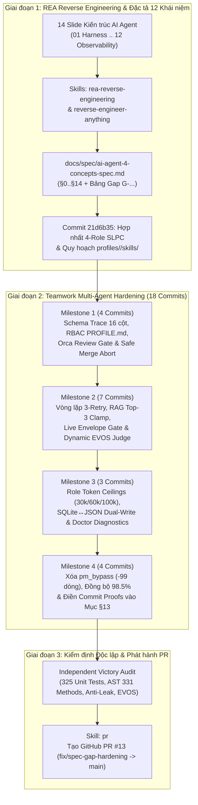

# Đặc Tả Kỹ Thuật Tổng Kết: Quy Trình Reverse Engineering 12 Khái Niệm AI Agent, Hardening Runtime 4-Role SLPC & Ma Trận Skills Thực Thi

> **Mã tài liệu**: `ARCH-SPEC-GAP-HARDENING-EXECUTION-SKILLS-2026-V1`  
> **Ngày ban hành**: `2026-10-27`  
> **Nhánh thực thi**: `fix/spec-gap-hardening` ([PR #13](https://github.com/baobao0303/Room_Agent/pull/13))  
> **Dải Commit**: `21d6b35..9e7dbe2` (`19` commits chuẩn hóa kiến trúc, runtime, test & tài liệu)  
> **Tài liệu liên kết**: [ai-agent-4-concepts-spec.md](file:///Users/bao312/Desktop/Room_Agent/docs/spec/ai-agent-4-concepts-spec.md) (`ARCH-SPEC-AI-AGENT-12-CONCEPTS-2026-V2`)  
> **Trạng thái**: `CERTIFIED & MERGE-READY (325/325 Tests PASS | EVOS 100.0% >= 98.5% | Anti-Leak 100% PASS)`

---

## 1. Tổng Quan Mục Tiêu & Phạm Vi Thực Thi

Tài liệu này đặc tả toàn bộ công việc đã thực hiện trong chiến dịch **Chuẩn hóa Kiến trúc 12 Khái niệm AI Agent & Hardening Hệ thống `Room_Agent`**, bao gồm:
1. **Dịch ngược (Reverse Engineering) và Đặc tả hóa 12 Khái niệm AI Agent cốt lõi** từ bộ 14 trang slide kiến trúc sang thực tế mã nguồn và binary của `Room_Agent`.
2. **Hợp nhất Mô hình Quản trị 4-Role SLPC (`supervisor`, `lead`, `peer`, `qc`)**: Sáp nhập vai trò `pm` vào `supervisor`, quy hoạch lại kho kỹ năng về `profiles/<role>/skills/` và `profiles/shared/skills/`.
3. **Đóng toàn bộ 13 lỗ hổng thực thi (`Group A — Real Defects`) và độ lệch tài liệu/code (`Group B — Doc/Code Drift`)** thông qua mô hình đội ngũ tự hành đa tác tử (`/teamwork-preview`) với 4 Milestones và cơ chế kiểm định đối kháng 5 lớp.

---

## 2. Ma Trận Skills & Công Cụ Chuyên Biệt Đã Sử Dụng

Trong suốt chu trình từ phân tích mã nguồn, dịch ngược binary, lập đặc tả, điều phối đội ngũ đa tác tử đến tạo Pull Request, hệ thống đã kích hoạt và phối hợp **7 nhóm Skills & Workflows chuyên biệt**:

| STT | Tên Skill / Workflow | Đường dẫn Skill (`SKILL.md`) | Vai trò & Cách thức Ứng dụng Thực tế trong Dự án |
| :-- | :--- | :--- | :--- |
| **1** | **`rea-reverse-engineering`** | [.agents/skills/rea-reverse-engineering/SKILL.md](file:///Users/bao312/Desktop/Room_Agent/.agents/skills/rea-reverse-engineering/SKILL.md) | Định hướng quy trình dịch ngược dựa trên bằng chứng thực nghiệm (*Evidence-First Reverse Engineering*), phân loại độ tin cậy (`CONFIRMED`, `INFERRED`, `HYPOTHESIS`) và trích xuất bảng đối soát kiến trúc. |
| **2** | **`reverse-engineer-anything`** | [.agents/skills/reverse-engineer-anything/SKILL.md](file:///Users/bao312/Desktop/Room_Agent/.agents/skills/reverse-engineer-anything/SKILL.md) | Chạy trực tiếp CLI `npx -y rea-agents@6.5.0` để mổ xẻ các thành phần đóng gói/nhị phân trong hệ sinh thái: • `rea inspect-rust-binary`: Giải phẫu binary Rust ELF 64-bit [scripts/bin/harness-cli](file:///Users/bao312/Desktop/Room_Agent/scripts/bin/harness-cli) (`sha256: 66eb9e...`), trích xuất danh sách crates (`rusqlite 0.31.0`, `clap 4.5.60`, `serde_json 1.0.149`), subcommands (`learn`, `supervise`, `gc`, `init`) và các hằng số biên dịch. • `rea extract-artifact`: Giải nén và kiểm tra gói Electron `/Applications/Orca.app/Contents/Resources/app.asar` (716 files, IPC channels `terminal:*`, `worktree:*`, `git:*`) cùng binary `/Applications/Orca.app/Contents/MacOS/Orca`. • Phân tích tĩnh Mach-O binary `agent-browser-darwin-arm64` và bản chụp SQLite `.harness/harness.db`. |
| **3** | **`/teamwork-preview` (Multi-Agent Team Orchestration)** | Subagent `teamwork_preview` ([c4cf6aa2-98d0-4af9-8be8-71b0b578c9cc](conversation://c4cf6aa2-98d0-4af9-8be8-71b0b578c9cc)) | Triển khai mô hình đội ngũ tự hành đa tầng để đóng toàn bộ các Gap `Group A` và `Group B`: • **Sentinel**: Giám sát nhịp tim (cron liveness), chống lệch mục tiêu và điều phối cổng nghiệm thu độc lập. • **Project Orchestrator**: Phân rã dự án thành 4 Milestones tuần tự, quản lý git branch và điều phối workers. • **Implementation Workers (`worker_m1..m4`)**: Trực tiếp sửa code Python/SQL/Shell/Docs và viết unit tests. • **5-Agent Gate (`Reviewer x2`, `Challenger x2`, `Forensic Auditor x1`)**: Kiểm định chéo từng Milestone; phát hiện và bắt buộc sửa các lỗi biên (dirty `.git/MERGE_HEAD`, legacy SQLite `NOT NULL`, float retry count `2.5`, chuỗi `"M4 Commit"`). • **Independent Victory Auditor**: Chạy kiểm tra độc lập 3 pha trên toàn bộ repo trước khi bàn giao. |
| **4** | **`pr`** | [.agents/skills/pr/SKILL.md](file:///Users/bao312/Desktop/Room_Agent/.agents/skills/pr/SKILL.md) | Thiết kế nội dung Pull Request [PR #13](https://github.com/baobao0303/Room_Agent/pull/13) theo đúng mẫu chuẩn Humanlayer (`## Summary` kèm sơ đồ luồng & diff tree, `## Evidence` đối chiếu Before/After bằng kết quả test thực tế, `## Merge Danger` phân tích `Two-way Door` và `Blast Radius`). |
| **5** | **`doc-updater` & `writing-for-agents`** | [.agents/skills/doc-updater/SKILL.md](file:///Users/bao312/Desktop/Room_Agent/.agents/skills/doc-updater/SKILL.md) [.agents/skills/writing-for-agents/SKILL.md](file:///Users/bao312/Desktop/Room_Agent/.agents/skills/writing-for-agents/SKILL.md) | Đồng bộ hóa chuẩn quản trị 4-role (`supervisor`, `lead`, `peer`, `qc`), ngưỡng EVOS Release Gate `98.5%`, và ma trận kỹ năng theo vai trò trên toàn bộ [AGENTS.md](file:///Users/bao312/Desktop/Room_Agent/AGENTS.md), [README.md](file:///Users/bao312/Desktop/Room_Agent/README.md), [CLAUDE.md](file:///Users/bao312/Desktop/Room_Agent/CLAUDE.md), [SOUL.md](file:///Users/bao312/Desktop/Room_Agent/SOUL.md), [MEMORY.md](file:///Users/bao312/Desktop/Room_Agent/MEMORY.md), [SOURCE_CODE_MAP.md](file:///Users/bao312/Desktop/Room_Agent/docs/SOURCE_CODE_MAP.md) và [COMMANDS.md](file:///Users/bao312/Desktop/Room_Agent/docs/COMMANDS.md). |
| **6** | **`harness-framework` & `harness-manager`** | [.agents/skills/harness-framework/SKILL.md](file:///Users/bao312/Desktop/Room_Agent/.agents/skills/harness-framework/SKILL.md) [.agents/skills/harness-manager/SKILL.md](file:///Users/bao312/Desktop/Room_Agent/.agents/skills/harness-manager/SKILL.md) | Áp dụng quy chuẩn máy trạng thái SDLC (`Todo` ➔ `In_Progress` ➔ `Resolved` ➔ `Closed` / `Blocked`), bảng `trace` 16 cột, bảng `intervention`, và cơ chế đồng bộ hai chiều giữa SQLite (`.harness/harness.db`) với JSON fallback (`.harness/local_db.json`). |
| **7** | **`loop-engineering`, `rtk` & `qc`** | [.agents/skills/loop-engineering/SKILL.md](file:///Users/bao312/Desktop/Room_Agent/.agents/skills/loop-engineering/SKILL.md) [.agents/skills/rtk/SKILL.md](file:///Users/bao312/Desktop/Room_Agent/.agents/skills/rtk/SKILL.md) [.agents/skills/qc/SKILL.md](file:///Users/bao312/Desktop/Room_Agent/.agents/skills/qc/SKILL.md) | Thiết kế vòng lặp khép kín (Closed Loop) tối đa 3 lần thử lại trong [run_pipeline.py](file:///Users/bao312/Desktop/Room_Agent/scripts/run_pipeline.py), kiểm tra chẩn đoán proxy nén token `rtk` trong [harness_doctor.py](file:///Users/bao312/Desktop/Room_Agent/tools/harness_doctor.py), và khóa độc quyền nghiệm thu `Closed` cho vai trò `qc`. |

---

## 3. Chi Tiết Công Việc Đã Thực Hiện Theo Từng Giai Đoạn

### 3.1. Giai Đoạn 1: Dịch Ngược (REA) & Viết Đặc Tả 12 Khái Niệm AI Agent (`21d6b35`)

Từ 3 đợt hình ảnh slide kiến trúc do User cung cấp (tổng cộng 14 ảnh: 12 khái niệm + 2 bản đồ tổng quan Vector Map), tiến hành đối chiếu từng khái niệm với mã nguồn thực tế và kết quả phân tích nhị phân REA để biên soạn tài liệu đặc tả trung tâm [ai-agent-4-concepts-spec.md](file:///Users/bao312/Desktop/Room_Agent/docs/spec/ai-agent-4-concepts-spec.md) (`1.070+` dòng, 15 chương `§0..§14`):

1. **`01 — Harness`**: Phân tích `scripts/bin/harness-cli` (Rust ELF binary), [harness_manager.py](file:///Users/bao312/Desktop/Room_Agent/tools/harness_manager.py), [slppc_orchestrator.py](file:///Users/bao312/Desktop/Room_Agent/plugins/slpc-lifecycle-hooks/slppc_orchestrator.py) và [dual_ide_hook.py](file:///Users/bao312/Desktop/Room_Agent/tools/dual_ide_hook.py).
2. **`02 — Agent`**: Phân tích vòng lặp ReAct (Reason + Act) và cấu hình 4 hồ sơ vai trò trong `profiles/<role>/PROFILE.md`.
3. **`03 — MCP (Model Context Protocol)`**: Phân tích cấu hình `.mcp.json` (`local-Mem0`, `local-tds-rag`, `chrome-devtools`) và cơ chế kết nối JSON-RPC.
4. **`04 — Loop Engineering`**: Phân tích cơ chế `Stop Hook`, trần vòng lặp (`MAX_STAGE_RETRIES = 3`), Kev System One (`< 50ms`) và đường thoát `Blocked`.
5. **`05 — RAG (Retrieval-Augmented Generation)`**: Phân tích công cụ BM25 [query_reader.py](file:///Users/bao312/Desktop/Room_Agent/tools/query_reader.py), [tds_search.py](file:///Users/bao312/Desktop/Room_Agent/tools/tds_search.py) và quy tắc tiêm tối đa Top-3 đoạn văn bản.
6. **`06 — Multi-Agent (SLPC Architecture)`**: Phân tích luồng bàn giao `Supervisor` ➔ `Lead` ➔ `Peer` ➔ `QC`, cấu trúc `AgentHandoffEnvelope` và cơ chế chống tràn ngữ cảnh.
7. **`07 — Memory (3-Tier Memory Architecture)`**: Phân tích Tier 1 (Working Context & ngưỡng nén theo role), Tier 2 (SQLite `.harness/harness.db` + JSON fallback) và Tier 3 ([SOUL.md](file:///Users/bao312/Desktop/Room_Agent/SOUL.md), [IDENTITY.md](file:///Users/bao312/Desktop/Room_Agent/IDENTITY.md), [MEMORY.md](file:///Users/bao312/Desktop/Room_Agent/MEMORY.md)).
8. **`08 — Evals (EVOS & Guardrails)`**: Phân tích [evos_engine.py](file:///Users/bao312/Desktop/Room_Agent/tools/evos_engine.py), [qc_test_generator.py](file:///Users/bao312/Desktop/Room_Agent/tools/qc_test_generator.py), [strict_typing_scanner.py](file:///Users/bao312/Desktop/Room_Agent/tools/strict_typing_scanner.py) và [anti_leak_sentinel.py](file:///Users/bao312/Desktop/Room_Agent/scripts/anti_leak_sentinel.py).
9. **`09 — Context Engineering`**: Phân tích cơ chế định tuyến 6 bước, bộ lọc `rtk` ([rtk_profile_env.sh](file:///Users/bao312/Desktop/Room_Agent/scripts/rtk_profile_env.sh)) và quy tắc đặc tả task `Zero-Search` 5 thành phần.
10. **`10 — Permission Gates`**: Phân tích 3 lớp rào cản thẩm quyền: `PROFILE.md` frontmatter, Git pre-commit guard (`setup.sh`) và cổng duyệt worktree (`cli/orca-review`).
11. **`11 — Computer Use & GUI Automation`**: Phân tích kiến trúc IPC của `/Applications/Orca.app`, `agent-browser-darwin-arm64` và Chrome DevTools MCP.
12. **`12 — Observability & Trace`**: Phân tích cấu trúc bảng `trace` 16 cột, nhịp tim [agent_heartbeat.py](file:///Users/bao312/Desktop/Room_Agent/tools/agent_heartbeat.py) và dọn dẹp PTY mồ côi [zombie_reaper.py](file:///Users/bao312/Desktop/Room_Agent/tools/zombie_reaper.py).

---

### 3.2. Giai Đoạn 2: Thực Thi Hardening Qua 4 Milestones (`8f5100c..9e7dbe2`)

#### Milestone 1: Chuẩn Hóa Database Schema & Rào Cản Thẩm Quyền (`G-OBS-1`, `G-HRN-1`, `G-HRN-2`, `G-PRM-3`)
- **Đồng bộ Schema `trace` (16 cột) & `intervention` (`8f5100c`, `6da661e`)**:
  - Hợp nhất DDL giữa [001-init.sql](file:///Users/bao312/Desktop/Room_Agent/scripts/schema/001-init.sql), [full_schema.sql](file:///Users/bao312/Desktop/Room_Agent/scripts/schema/full_schema.sql), [008-trace-schema.sql](file:///Users/bao312/Desktop/Room_Agent/scripts/schema/008-trace-schema.sql) và [`HarnessManager._init_local_sqlite()`](file:///Users/bao312/Desktop/Room_Agent/tools/harness_manager.py).
  - Triển khai quy trình **12-step SQLite table-copy migration** tự động nâng cấp các bảng `trace` thế hệ cũ (vốn có ràng buộc `content NOT NULL`) mà không làm mất dữ liệu lịch sử.
- **Thực thi Phân quyền RBAC từ `PROFILE.md` (`f3d2a4c`)**:
  - Bổ sung hàm đọc YAML frontmatter `permissions` từ `profiles/<role>/PROFILE.md` trong [harness_manager.py](file:///Users/bao312/Desktop/Room_Agent/tools/harness_manager.py).
  - Cưỡng chế kiểm tra quyền trên mọi lệnh chuyển trạng thái: chỉ duy nhất `qc` (`can_close_task: true`) được phép chuyển task sang `Closed`; nếu `peer`, `lead` hoặc `supervisor` cố đóng task sẽ bị chặn ngay lập tức với ngoại lệ `PermissionError`.
- **Khóa Cổng Duyệt Worktree `orca-review approve` (`bbe5953`, `6da661e`)**:
  - Trong [orca_worktree_manager.py](file:///Users/bao312/Desktop/Room_Agent/tools/orca_worktree_manager.py), chặn hoàn toàn thao tác `git merge` nếu task chưa ở trạng thái `Resolved` hoặc chưa có biên bản QC PASS.
  - Hiển thị bảng `git diff --stat` trước khi gộp nhánh, tự động gọi `abort_merge_safely()` để dọn sạch `.git/MERGE_HEAD` nếu phát sinh xung đột merge, và ghi nhận mọi quyết định `approve`/`reject` vào bảng `intervention`.

#### Milestone 2: Vòng Lặp 3-Retry, RAG Top-3, Envelope Gate & Chấm Điểm Động EVOS (`G-LOP-1`, `G-OBS-2`, `G-RAG-1`, `G-MAG-1`, `G-EVL-2`, `G-EVL-3`)
- **Xóa bỏ Điểm Gán Cứng trong EVOS Engine (`e8acbc2`)**:
  - Trong [evos_engine.py](file:///Users/bao312/Desktop/Room_Agent/tools/evos_engine.py), loại bỏ hoàn toàn dòng gán cứng `accuracy_score = 100.0`.
  - Tính toán `accuracy_score` động từ kết quả thực thi bộ test Golden Dataset và kiểm toán SLPPC; nếu dữ liệu chấm điểm bị thiếu hoặc không thể truy cập, trả về trạng thái `INCONCLUSIVE` (`passed: False`, `production_approved: False`).
- **Giới hạn Cứng Top-3 RAG & Kiểm định `AgentHandoffEnvelope` Trực tiếp (`901a01f`, `d3c03a9`, `44fc985`, `d4d9b0b`)**:
  - Trong [`build_context_bounded_prompt()`](file:///Users/bao312/Desktop/Room_Agent/tools/query_reader.py), ép trần `max_chunks = min(max(1, int(max_chunks)), 3)` để đảm bảo không bao giờ bơm quá 3 đoạn mã vào context của Agent.
  - Trong [`safe_send_agent_message()`](file:///Users/bao312/Desktop/Room_Agent/tools/agent_context_manager.py), tích hợp kiểm định trực tiếp qua [`validate_agent_handoff_envelope()`](file:///Users/bao312/Desktop/Room_Agent/tools/slppc_flow_guard.py) (chặn cả chuỗi toàn khoảng trắng và số thực `retry_count` không nguyên như `2.5`).
- **Vòng lặp Cơ học 3-Retry & Trace Span theo `run_id` (`63adf20`, `f25a902`)**:
  - Trong [run_pipeline.py](file:///Users/bao312/Desktop/Room_Agent/scripts/run_pipeline.py), triển khai vòng lặp thử lại tối đa `MAX_STAGE_RETRIES = 3` khi Peer thực thi hoặc chạy test thất bại, tự động truyền `last_error_feedback` vào lần thử kế tiếp.
  - Khi vượt quá 3 lần thử, tự động chuyển trạng thái task sang `Blocked` và ghi biên bản cảnh báo khẩn cấp cho Supervisor tại `bmad/rooms/supervisor/blocked_alert_<id>.md`.
  - Ghi nhận span vào bảng `trace` ở mỗi chặng pipeline với cùng một `run_id` thống nhất; hỗ trợ cả `story_id` dạng chuỗi chữ-số mà không vi phạm khóa ngoại SQLite.

#### Milestone 3: Kiến Trúc Bộ Nhớ 3 Tầng & Chẩn Đoán Hệ Thống (`G-MEM-1`, `G-MEM-2`, `G-MEM-4`, `G-MEM-5`, `G-AGT-1`, `G-CTX-1`)
- **Ngưỡng Nén Ngữ cảnh theo Vai trò & Nạp Toàn văn `MEMORY.md` (`56865e5`)**:
  - Trong [agent_context_manager.py](file:///Users/bao312/Desktop/Room_Agent/tools/agent_context_manager.py), áp dụng bảng trần token riêng biệt: `peer`/`qc` (`30.000` tokens), `lead` (`60.000` tokens), `supervisor` (`100.000` tokens).
  - Nạp đầy đủ toàn bộ nội dung [MEMORY.md](file:///Users/bao312/Desktop/Room_Agent/MEMORY.md) (bao gồm cả `## Key Decisions`, `## Known Gotchas`, `## Pending Decisions`) khi tái nạp ngữ cảnh thay vì chỉ trích xuất một mục đơn lẻ.
- **Đồng bộ Hai chiều SQLite ↔ JSON Fallback (`fabf6dc`)**:
  - Trong [harness_manager.py](file:///Users/bao312/Desktop/Room_Agent/tools/harness_manager.py), hợp nhất kho kinh nghiệm (`experience`) với cơ chế ghi kép (dual-write) và đồng bộ hai chiều giữa `.harness/harness.db` và `.harness/local_db.json` (khử trùng lặp theo khóa nội dung).
- **Hiển thị Cảnh báo Lỗi & Chẩn đoán RTK Binary (`f5a3233`)**:
  - Loại bỏ các khối `except Exception: pass` nuốt lỗi âm thầm khi đọc file bộ nhớ hoặc gọi binary; ghi rõ cảnh báo ra `sys.stderr`.
  - Bổ sung kiểm tra sự tồn tại của binary `rtk` và cấu hình alias trong [harness_doctor.py](file:///Users/bao312/Desktop/Room_Agent/tools/harness_doctor.py).

#### Milestone 4: Dọn Dẹp Dead Code PM, Đồng Bộ Tài Liệu 4-Role & Khóa Bảng Đối Soát `§13`
- **Xóa bỏ `pm_bypass` & Đồng bộ Công cụ 4-Role (`4437649`)**:
  - Xóa hoàn toàn hàm `audit_pm_bypass()` và các tham chiếu `pm_bypass` (`-99` dòng) khỏi [slppc_flow_guard.py](file:///Users/bao312/Desktop/Room_Agent/tools/slppc_flow_guard.py).
  - Cập nhật [harness_doctor.py](file:///Users/bao312/Desktop/Room_Agent/tools/harness_doctor.py) và [run_pipeline.py](file:///Users/bao312/Desktop/Room_Agent/scripts/run_pipeline.py) (`run_supervisor_intake_gate`) theo đúng 4 vai trò chuẩn (`supervisor`, `lead`, `peer`, `qc`).
- **Đồng bộ Ngưỡng Release Gate `98.5%` & Tài liệu Toàn Hệ thống (`019f015`)**:
  - Chuẩn hóa con số `98.5%` và kiến trúc 4-role trên [AGENTS.md](file:///Users/bao312/Desktop/Room_Agent/AGENTS.md), [README.md](file:///Users/bao312/Desktop/Room_Agent/README.md), [CLAUDE.md](file:///Users/bao312/Desktop/Room_Agent/CLAUDE.md), [SOUL.md](file:///Users/bao312/Desktop/Room_Agent/SOUL.md), [MEMORY.md](file:///Users/bao312/Desktop/Room_Agent/MEMORY.md), [SOURCE_CODE_MAP.md](file:///Users/bao312/Desktop/Room_Agent/docs/SOURCE_CODE_MAP.md), [COMMANDS.md](file:///Users/bao312/Desktop/Room_Agent/docs/COMMANDS.md) và toàn bộ `profiles/`.
- **Cập nhật Ma trận Đối soát Gap `§13` kèm Mã Commit Thực tế (`fd27077`, `9e7dbe2`)**:
  - Điền đầy đủ mã commit giải quyết và lệnh kiểm chứng cơ học cho từng Gap trong mục `§13` của [ai-agent-4-concepts-spec.md](file:///Users/bao312/Desktop/Room_Agent/docs/spec/ai-agent-4-concepts-spec.md) (`100%` commit hashes hợp lệ khi kiểm tra bằng `git cat-file -e`).

---

## 4. Danh Sách 19 Commits Trên Nhánh `fix/spec-gap-hardening`

| STT | Commit Hash | Milestone | Thông điệp Commit & Tác động Chính |
| :-- | :--- | :--- | :--- |
| 1 | `21d6b35` | **Base** | `refactor(roles): consolidate to 4-role SLPC (PM merged into Supervisor), move skills into profiles/<role>/; add AI agent 12-concept spec` |
| 2 | `8f5100c` | **M1** | `feat(obs): harmonize trace and intervention schema across SQL and tools (G-OBS-1)` |
| 3 | `f3d2a4c` | **M1** | `feat(harness): enforce role permissions from profile frontmatter (G-HRN-1, G-HRN-2)` |
| 4 | `bbe5953` | **M1** | `feat(orca): enforce worktree review gate, diffstat preview, and intervention logging (G-PRM-3)` |
| 5 | `6da661e` | **M1 (Fix)** | `fix(orca,harness): abort on merge conflict and use table-copy migration for trace schema` |
| 6 | `e8acbc2` | **M2** | `fix(evos): compute dynamic accuracy and handle missing judge data for G-EVL-2 and G-EVL-3` |
| 7 | `901a01f` | **M2** | `feat(rag,context): add top-3 clamping and live envelope validation for G-RAG-1 and G-MAG-1` |
| 8 | `63adf20` | **M2** | `feat(pipeline): implement retry loop and stage spans for G-LOP-1 and G-OBS-2` |
| 9 | `d3c03a9` | **M2 (Fix)** | `fix(orchestrator): retain self-learning header with context-bounded prompt` |
| 10 | `f25a902` | **M2 (Fix)** | `fix(harness): harden trace record foreign key stub insertion against alphanumeric story IDs` |
| 11 | `44fc985` | **M2 (Fix)** | `fix(guard,test): harden handoff envelope validation and fix audit false positive for evos release gate` |
| 12 | `d4d9b0b` | **M2 (Fix)** | `fix(guard,test): harden envelope validation against float retry counts and top-level whitespace strings` |
| 13 | `56865e5` | **M3** | `feat(memory): implement role-specific compaction thresholds and full MEMORY.md rehydration for G-MEM-1 and G-MEM-5` |
| 14 | `fabf6dc` | **M3** | `feat(memory): unify experience store across SQLite and JSON fallback for G-MEM-2` |
| 15 | `f5a3233` | **M3** | `feat(diagnostics): unswallow rehydration and exec errors, add RTK binary checks and warnings for G-AGT-1, G-MEM-4, G-CTX-1` |
| 16 | `4437649` | **M4** | `refactor(cleanup): remove dead PM bypass and align doctor, manager, and pipeline with canonical 4-role model` |
| 17 | `019f015` | **M4** | `docs(sync): harmonize 98.5% release gate and 4-role architecture across docs, souls, and profiles` |
| 18 | `fd27077` | **M4** | `docs(spec): update Section 13 gap tracking matrix with resolution proofs and test commands` |
| 19 | `9e7dbe2` | **M4 (Fix)** | `docs(spec): replace M4 Commit placeholders with concrete commit hashes in Section 13` |

---

## 5. Kết Quả Kiểm Định Cơ Học Độc Lập (Mechanical Verification Suite)

Toàn bộ mã nguồn trên nhánh `fix/spec-gap-hardening` đã vượt qua bộ kiểm định cơ học 6 cổng:

| Cổng Kiểm Định | Lệnh Thực Thi | Kết Quả Thực Tế |
| :--- | :--- | :--- |
| **1. Unit Test Suite** | `python3 -m unittest discover -s tools/tests` | **PASS**: `325` unit tests (`0` failures, `0` errors, `1` skipped). |
| **2. AST Assertion Integrity** | Phân tích cây cú pháp AST trên `47` file test (`331` test methods) | **CLEAN**: `0` hàm test rỗng (`pass`), `0` assertion giả (`assert True`). |
| **3. EVOS Release Gate** | `python3 tools/evos_engine.py --json` | **PASS**: `combined_pass_rate: 100.0% >= 98.5%`, `production_approved: true`. |
| **4. Anti-Leak Sentinel** | `python3 scripts/anti_leak_sentinel.py` | **PASS 100%**: Không rò rỉ thông tin nhạy cảm, domain nội bộ hoặc secrets. |
| **5. SLPPC Flow Guard** | `python3 tools/slppc_flow_guard.py audit` | **PASS**: `0` vi phạm quy trình 4-role SLPC. |
| **6. Syntax & Compile Check** | `python3 -m compileall -q tools scripts plugins && bash -n setup.sh` | **PASS**: Exit code `0`. |

---

## 6. Các Hạng Mục Bảo Lưu Theo Chỉ Thị User (`Pending / Out-of-Scope`)

1. **`G-PRM-1` (Cấu hình `modeId` trong `~/.paseo/config.json`)**:
   - Hiện tại cả 4 profile trong `~/.paseo/config.json` đang đặt `"modeId": "full-access"`.
   - Theo chỉ thị trực tiếp của User (*"Tạm thời chưa nhưng note lại"*), cấu hình này được giữ nguyên để phục vụ luồng tự động hóa hiện tại và đã được ghi nhận vào mục `## Pending Decisions` trong [MEMORY.md](file:///Users/bao312/Desktop/Room_Agent/MEMORY.md).
2. **`Group C` (Các tính năng mở rộng ngoài phạm vi Hardening hiện tại)**:
   - Tích hợp Vector Database / Semantic Embeddings (hiện dùng BM25 stdlib thuần).
   - Biên dịch lại binary Rust `scripts/bin/harness-cli` sang kiến trúc macOS `arm64` Mach-O (hiện dùng cơ chế tự động fallback sang SQLite/JSON Python).
   - Mở rộng bộ Golden Dataset lên 1.000 kịch bản kiểm thử.
